# UML 图集：23 种模式 + 2 个组合案例

> 为什么单独一篇：文字讲「谁持有谁、谁调谁」很费劲，一张图三秒就看完。
> 全篇用 [Mermaid](https://mermaid.js.org/syntax/classDiagram.html) 写，GitHub、VS Code、IntelliJ 都能直接渲染，不需要装画图工具。
>
> **每张图都对着 `src/` 下的真实类名画**，不是照抄 GoF 原书的示意图。改代码之后 请同步改图，否则图比文档更容易骗人。
>
> **配套阅读**：[docs 导航](README.md) ｜ [选择指南](pattern-selection-guide.md)（何时该抽象） ｜ [组合与继承](07-composition-vs-inheritance.md)（机制分类） ｜ [综合练习](practice/README.md)（自己画一遍）

## 0. 怎么读这些图

### 0.1 箭头速查

| 写法 | 含义 | 一句话 |
|---|---|---|
| `A <\|-- B` | 继承 | B **是一种** A |
| `A <\|.. B` | 实现 | B **实现了**接口 A |
| `A --> B` | 关联 | A **持有** B 的引用（字段），B 由外部创建或注册 |
| `A o-- B` | 聚合 | A 持有一组 B，B 是 A 的组成部分，但可以独立存在 |
| `A *-- B` | 组合 | A **独占创建** B，B 不对外泄漏，A 没了 B 也没人用 |
| `A ..> B` | 依赖 | A 在方法里**临时用到** B（参数、局部变量、返回值，含方法内 new 完就返回） |

#### 0.1.1 画 `*--` 之前先过三个条件

| # | 条件 | 本项目的反例 |
|---|---|---|
| 1 | A **持有** B 的字段（不是只在方法里 `new`） | `TextDocument.layout()` 里 new 出 `CharacterView` 再返回——应画 `..>` |
| 2 | B **由 A 创建**，不是外部传进来、注册进来 | `ContentCreator.subscribe(observer)` 的观察者——应画 `-->` |
| 3 | B **不对外泄漏**，A 没了 B 就没人用 | `Directory.children()` 返回副本，节点仍可被外部引用——应画 `o--` |

**最容易犯的错：把 static nested class 当成组合。** `Computer.Builder` 写成 `Computer` 的静态内部类，编译后类名是 `Computer$Builder`，这**只是命名空间归属**：

- `Computer` 的 6 个字段（`cpu/memory/hardDisk/gpu/powerSupply/caseType`）里**没有** `Builder`；
- `Builder` 也不持有 `Computer`，它只在 `build()` 里把字段读出来 `new Computer(this)`；
- 两者生命周期互不绑定：`new Computer.Builder()` 可以独立存在，`Computer` 用完丢掉后 Builder 照样能用。

所以画 `Computer *-- Builder` 是**错的**，那一节里改成了两条 `..>` 依赖。Java 的内嵌类解决的是「这个类型只服务外部类」的命名与访问问题，**与「对象组合」是两个维度的事**。

> 按这三条查一遍，**本项目 25 张类图里一条 `*--` 都不该有**——因为没有任何一个模式真的独占创建并封装了另一个对象。练习 [01](practice/01-order-discount.md) / [05](practice/05-api-request.md) 里原本各有一条 `*--`，按同一标准也已改成 `o--`（节点都是 Builder 装配后传入的）。这本身就是个结论：GoF 模式用组合，用的大多是「可替换」和「可独立存在」，不是「强拥有」。

#### 0.1.2 三种「看起来像组合」的写法

这三个东西在 Java 里都长着「A 和 B 有关系」的样子，但在 UML 里根本不是一种箭头：

| 写法 | 项目里的例子 | 是对象组合吗 | 该画什么 |
|---|---|---|---|
| **静态嵌套类** | `Computer.Builder`（编译成 `Computer$Builder`） | 不是。只是把类型定义放进外部类的名字空间，`Computer` 没有 `Builder` 字段 | `..>`（创建 / 读取各一条） |
| **静态字段引用** | `Order.state = PendingState.INSTANCE`、`EagerSingleton.INSTANCE` | 不是。实例在类初始化时创建唯一一份，所有宿主共享；宿主没了它还在 | 写在属性行，或画 `-->` |
| **实例字段（对象组合）** | `PriceCalculator.strategy`、`Directory.children` | 是。每个宿主实例各持一份，随宿主创建 / 丢弃 | `-->`（单个）或 `o--`（一组） |

判据只有一句：**「B 是不是 A 这个对象的部件」**。静态嵌套类答「不是，那是类型」；静态字段答「不是，那是全类共享的一份常量」；只有实例字段答「是」。

#### 0.1.3 `o--` 与 `-->` 只差一件事：有没有「整体-部分」

| 写法 | 判据 | 例子 |
|---|---|---|
| `o--` 聚合 | A 持有 B 的**一组**，且这组 B **构成 A 的内容**；B 由外部创建或可被外部引用，能独立存在 | `Workflow` 的 `roots`、`MacroCommand` 的 `commands`、`DocumentBundle` 的 `documents` |
| `-->` 关联 | A 持有 B 的**一个**引用，或者 B 是**注册进来**的协作者，不是 A 的内容 | `Order.state`（可替换）、`ContentCreator.observers`（外部 `subscribe`） |

两个边界例子，本项目按「能画 `-->` 就不画 `o--`、能画 `o--` 就不画 `*--`」的保守口径处理，并在图后写明理由：

- `Order o-- HistoryEntry`：`history` 是 `List<HistoryEntry>`，条目由 `Order` 在做状态转移时创建、只服务这张订单的审计轨迹，形态上是聚合；但 `history()` 会把快照交给外部（日志 / 前端要看），**不满足「不对外泄漏」**，所以不升级成 `*--`。
- `DispatchReport o-- Delivery`：报告是**值的快照**，里面的 `deliveries` 是 `List.copyOf` 复制来的引用；投递渠道本身由发布方创建、也被观察者共享，因此不可能是组合。

### 0.2 每个模式的图后面固定四行

- **谁创建**：谁负责 `new`
- **谁持有**：变化时换掉的是哪个字段
- **谁控制流程**：调用从哪进、在哪回调
- **变化点**：新增一种实现时，需要改哪个文件

这四行比图本身更有用——UML 只告诉你「现在是什么」，这四行告诉你「以后会变成什么」。

### 0.3 图的取舍

只画**承担模式语义**的角色。`Client`、`util.Money`、`util.DisplayWidth` 这类周边类默认不画，出现在图里说明它在这个模式里有职责（比如 `Director`）。

---

## 一、创建型（5 种）

### 1. 单例 Singleton

这个模式没有协作对象，图里只有「如何保证唯一」。

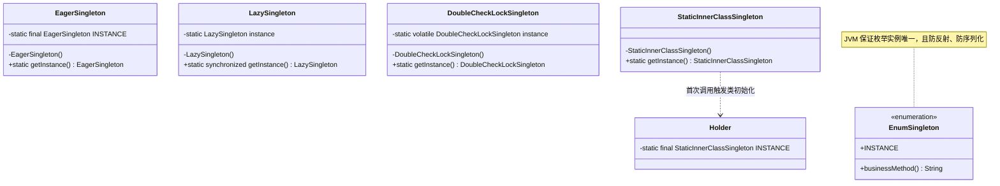

- **谁创建**：类自己（构造器私有）
- **谁持有**：类自己的静态字段
- **谁控制流程**：调用方 `getInstance()`，之后全是普通方法调用
- **变化点**：换实现方式（饿汉 → DCL → 枚举）只改这一个类，调用方不动

`StaticInnerClassSingleton` 与 `Holder` 的关系值得单独看：**外部类不持有实例，内部类才持有**，所以外部类加载时不会触发实例创建，这就是「懒加载 + 线程安全」同时成立的原因。这也是图里把它画成 `..>`（首次调用触发类初始化）而不是持有关系的原因。

`EagerSingleton` / `LazySingleton` / `DoubleCheckLockSingleton` 都把一个「自己的实例」放在 `static` 字段里，但图里没有画 `*--` 自环 —— **静态字段不是对象组合**：那一份实例在类初始化时创建、被全类共享，和任何「整体」都没有生命周期绑定（见 §0.1.2）。

### 2. 工厂方法 Factory Method

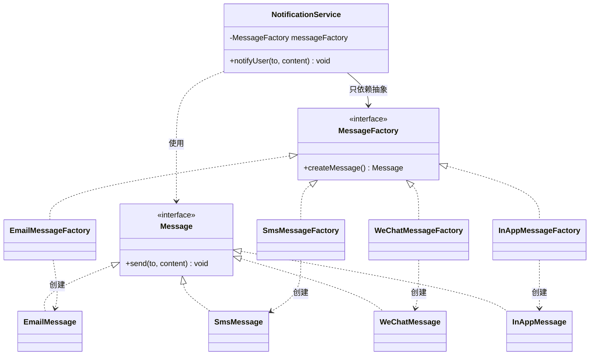

- **谁创建**：具体工厂（`EmailMessageFactory` 等）
- **谁持有**：`NotificationService` 持有 `MessageFactory`
- **谁控制流程**：`notifyUser()` 里先 `createMessage()` 再 `send()`
- **变化点**：加一种渠道 = 新增 `XxxMessage` + `XxxMessageFactory`，`NotificationService` 零改动

> 注意这张图里**没有继承**：`MessageFactory` 是接口，不是抽象类。GoF 原书用抽象类 + 子类，本项目用接口 + 实现类，语义一样（把 `new` 推迟到实现方），但「延迟到子类」的继承味道没有了。这个差别在 [07-composition-vs-inheritance.md](07-composition-vs-inheritance.md) §0.1 里有专门说明。

### 3. 抽象工厂 Abstract Factory

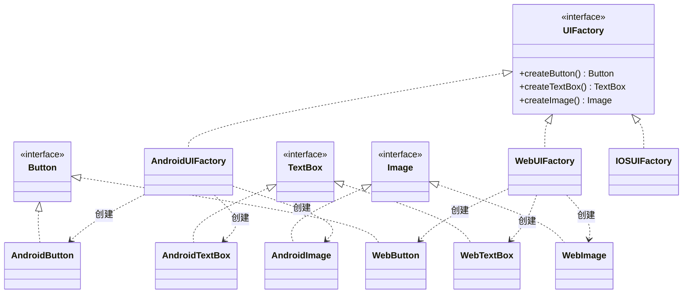

- **谁创建**：同族的具体工厂（一个平台一个工厂）
- **谁持有**：`Client` 持有 `UIFactory`（只持有一个）
- **谁控制流程**：Client 调 `createXxx()` 造出同族产品，再统一调用产品方法
- **变化点**：加一个平台 = 新增一个 `UIFactory` 实现 + 三个产品实现；**加一种产品 = 改 `UIFactory` 接口 + 所有实现**（这是抽象工厂的固有代价）

> 与工厂方法的分界：工厂方法管**一个产品**，抽象工厂管**一族产品**。图里能直接看出来——`UIFactory` 有三个工厂方法。

### 4. 建造者 Builder

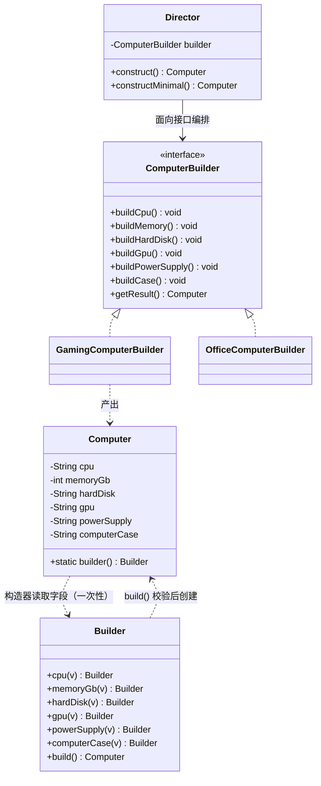

- **谁创建**：`Computer.Builder`（链式）或 `Director` + `ComputerBuilder`（编排）
- **谁持有**：`Director` 持有 `ComputerBuilder`；`Builder` 暂存半成品字段
- **谁控制流程**：`Director.construct()` 固定调用顺序；`Builder.build()` 做最后校验
- **变化点**：加一种机型 = 新增一个 `ComputerBuilder`；加一个可选参数 = 只改 `Builder` 加一个方法

> 这里出现了两个不同形状的 Builder，是刻意的：`Computer.Builder` 是**静态嵌套类**，`ComputerBuilder` 是**接口 + 实现类**（供 `Director` 编排）。前者是「简化 Builder」，后者是 GoF 原书的经典形态。
>
> **`Computer.Builder` 不要画成 `*--`。** 静态嵌套类只是把 `Builder` 的定义放进 `Computer` 的名字空间（编译成 `Computer$Builder.class`），`Computer` 并没有 `Builder` 字段，两者生命周期也不绑定。真正的关系只有两条依赖：`Builder.build()` 创建 `Computer`，`Computer` 的私有构造器从 `Builder` 读一次字段。**嵌套 ≠ 组合**，这是本图集最容易画错的一处。

### 5. 原型 Prototype

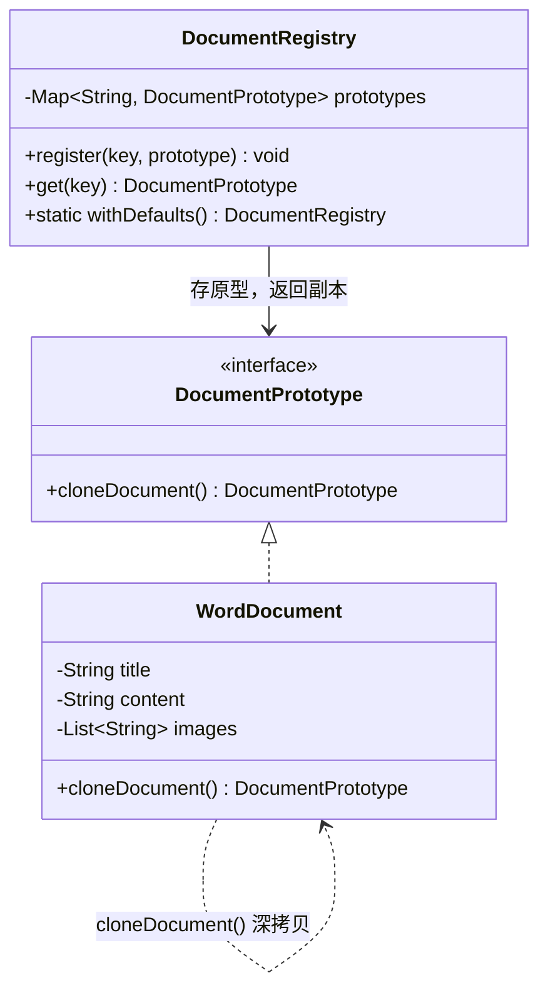

- **谁创建**：原型对象自己（`cloneDocument()`）
- **谁持有**：`DocumentRegistry` 持有 `Map<String, DocumentPrototype>`
- **谁控制流程**：调用方 `registry.get(key)` 拿到副本，registry 从不返回原型本身
- **变化点**：加一种文档类型 = 新增一个原型实现并注册，`DocumentRegistry` 不改

> 图里的自环（`WordDocument ..> WordDocument`）是关键：**原型模式里「创建者」和「被创建者」是同一个类**。这是它和工厂方法最容易分辨的一处。

---

## 二、结构型（7 种）

### 6. 适配器 Adapter

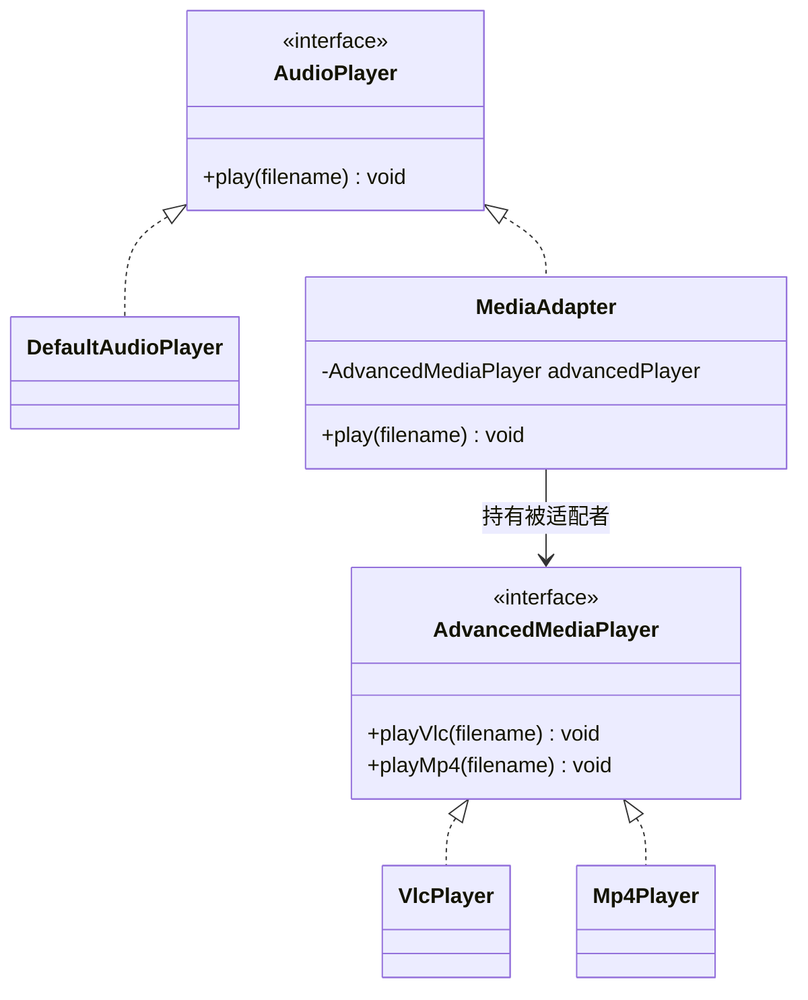

- **谁创建**：调用方（或工厂）创建 `MediaAdapter`，构造时传入具体播放器
- **谁持有**：`MediaAdapter` 持有 `AdvancedMediaPlayer`
- **谁控制流程**：`AudioPlayer.play()` → `MediaAdapter.play()` → 判扩展名 → `playVlc()` / `playMp4()`
- **变化点**：支持新格式 = 新增一个 `AdvancedMediaPlayer` 实现 + 在适配器里加一个分支；**调用方永远只看见 `AudioPlayer`**

> 适配器与装饰器的图形状几乎一样（都是「实现接口 + 持有一个对象」），区别在**语义**：适配器持有的是**不同接口**的对象（转换契约），装饰器持有的是**同一接口**的对象（叠加行为）。这一点在 [02-pattern-comparison.md](02-pattern-comparison.md) §2.1 有三问判别法。

### 7. 桥接 Bridge

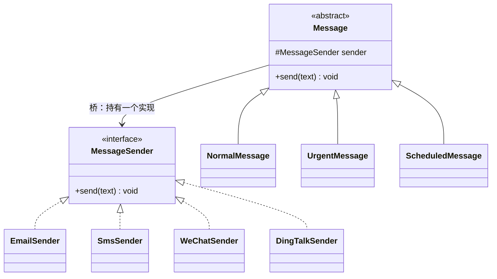

- **谁创建**：调用方分别创建「消息类型」和「发送渠道」，再拼起来
- **谁持有**：`Message` 持有 `MessageSender`
- **谁控制流程**：`message.send(text)` → 消息类加工内容 → `sender.send(加工后的内容)`
- **变化点**：加消息类型 = 新增 `Message` 子类；加渠道 = 新增 `MessageSender` 实现。**两个维度独立扩展**

> 这张图最能说明「为什么桥接能压住类爆炸」：继承方案要 `3 × 4 = 12` 个类，桥接只要 `3 + 4 = 7` 个。图里左右两列就是两条独立的继承线，中间那根 `-->` 就是「桥」。

### 8. 组合 Composite

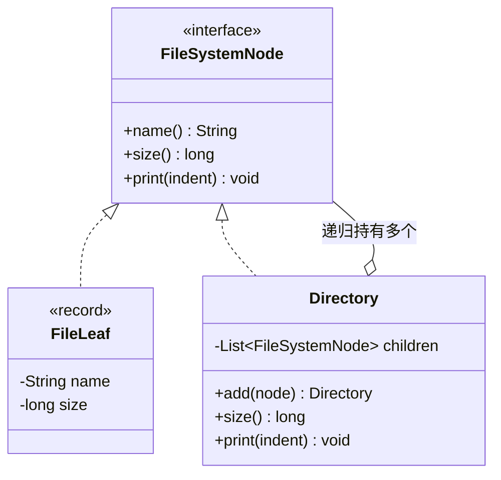

- **谁创建**：调用方逐个 `new`，用 `Directory.add()` 组装成树
- **谁持有**：`Directory` 持有 `List<FileSystemNode>`
- **谁控制流程**：`size()` / `print()` 在容器里递归调用子节点，叶子直接返回自身结果
- **变化点**：加一种节点 = 新增一个 `FileSystemNode` 实现；**调用方对所有节点一视同仁**

> 本项目用的是「安全式」而不是「透明式」：`add()` 只定义在 `Directory` 上，`FileSystemNode` 接口里没有它。代价是调用方要区分叶子和容器，收益是叶子节点上永远不会出现「往文件里加子文件」这种无意义调用。两种写法的取舍见 [composite/README.md](../src/com/patterns/structural/composite/README.md)。

### 9. 装饰器 Decorator

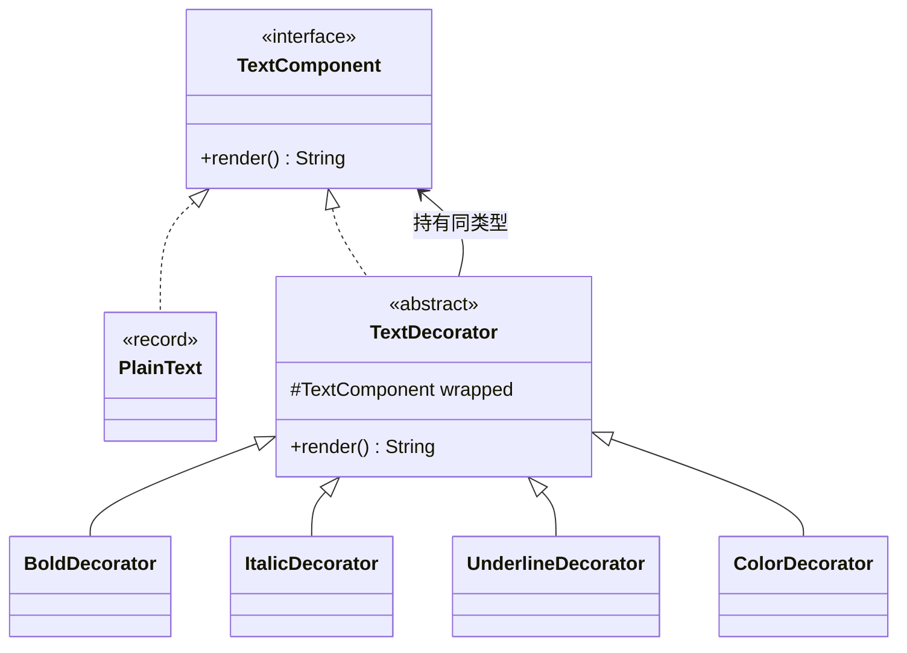

- **谁创建**：调用方一层层 `new`（顺序即语义）
- **谁持有**：`TextDecorator` 持有 `TextComponent wrapped`
- **谁控制流程**：`最外层.render()` → `wrapped.render()` → … → `PlainText.render()`，返回值一路上色/加粗
- **变化点**：加一种效果 = 新增一个 `TextDecorator` 子类，**不改任何已有类**

> 「实现接口 + 持有同类型」是装饰器的形状签名。它和代理的区别不在结构，在**意图**：装饰器是「给你加功能，加几层你说了算」，代理是「替你挡一下，调用方通常不知道」。

### 10. 外观 Facade

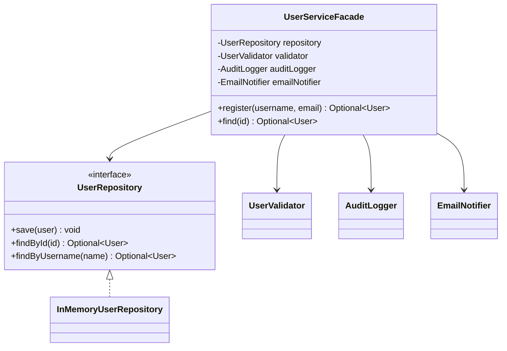

- **谁创建**：调用方创建（或由更外层容器注入）`UserServiceFacade`
- **谁持有**：facade 持有 4 个子系统引用
- **谁控制流程**：`register()` 内部按固定顺序「校验 → 查重 → 落库 → 审计 → 发邮件」
- **变化点**：换一个子系统实现（比如换数据库）= 只改 facade 的构造参数；**子系统之间依然互不认识**

> 关键点：子系统**不知道 facade 存在**（图里没有任何箭头从子系统指回 facade）。一旦子系统反向依赖 facade，外观就退化成一个普通的业务类。

### 11. 享元 Flyweight

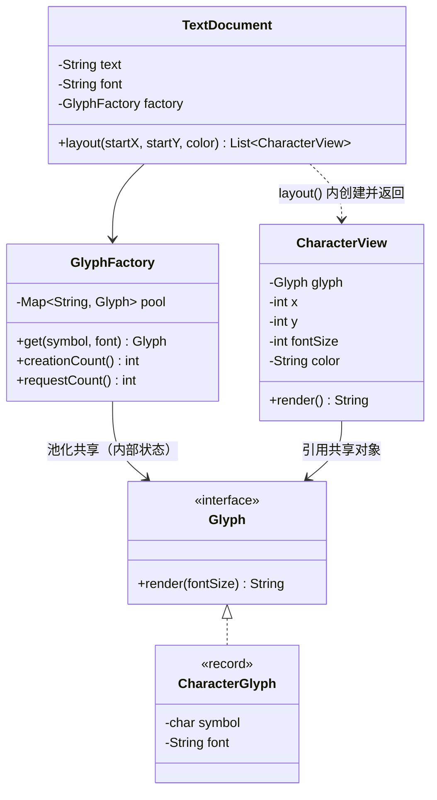

- **谁创建**：`GlyphFactory.get()`（池里没有才创建）
- **谁持有**：工厂持有池；`CharacterView` 持有共享的 `Glyph`；**`TextDocument` 只持有 `text` / `font` / `factory`，排版结果是 `layout()` 的返回值，不是一个字段**
- **谁控制流程**：`TextDocument.layout()` → `factory.getGlyph(ch, font)` 拿共享字形 → `new CharacterView(...)` 存位置/字号/颜色
- **变化点**：加一种字体 = 池里多几个 key；**共享对象的数量不随文本长度增长**

> 这张图的核心是「**内部状态 vs 外部状态**」：`symbol` + `font` 存进享元（可共享），`x/y/fontSize/color` 留在 `CharacterView`（不可共享）。画 UML 时如果只画 `Glyph` 和 `GlyphFactory`，就丢掉了这个模式最重要的一半。
>
> 另一个容易被画错的地方：`TextDocument` **不持有** `CharacterView` 列表，它每次都按文本重新排版并返回一个新列表。所以这里用 `..>` 而不是 `o--`——是否「持有」以字段为准，不以「方法返回了这类对象」为准。

### 12. 代理 Proxy

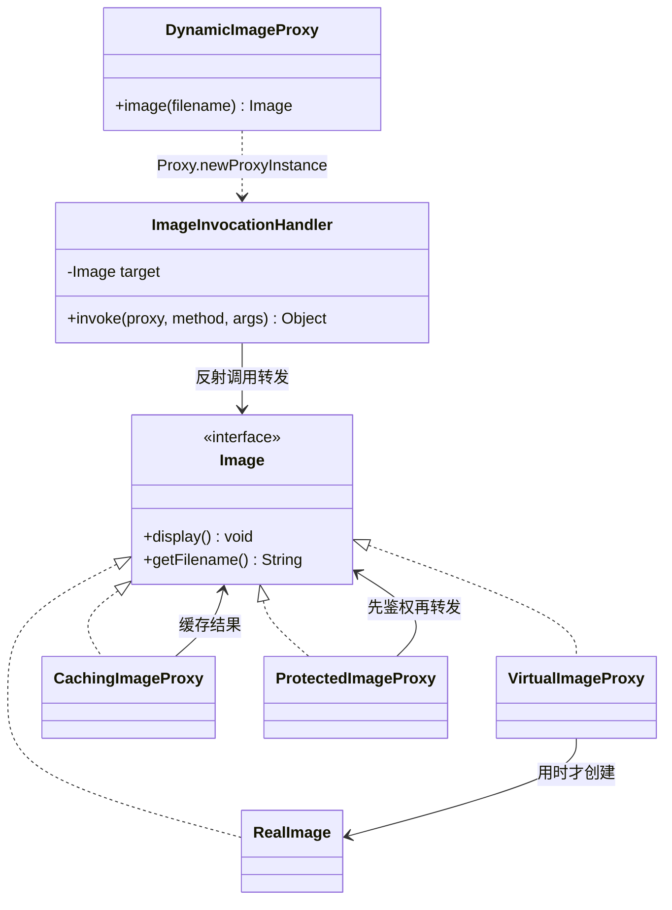

- **谁创建**：静态代理由调用方创建；动态代理由 `Proxy.newProxyInstance()` 在运行时生成
- **谁持有**：每个代理持有真实对象（动态代理是 handler 持有）
- **谁控制流程**：调用方 → 代理 → （判断/缓存/鉴权）→ 真实对象
- **变化点**：加一种「访问控制」= 新增一个代理类；动态代理则连类都不用写，只写 handler

> 前三个静态代理是三种典型动机：**虚代理**（延迟创建）、**缓存代理**（记住结果）、**保护代理**（检查权限）。动态代理单列一条线，因为它的类不是写出来的，是 `Proxy` 运行时生成的——图里用 `..>` 依赖表示这层「运行时才存在」的关系。

---

## 三、行为型（11 种）

### 13. 责任链 Chain of Responsibility

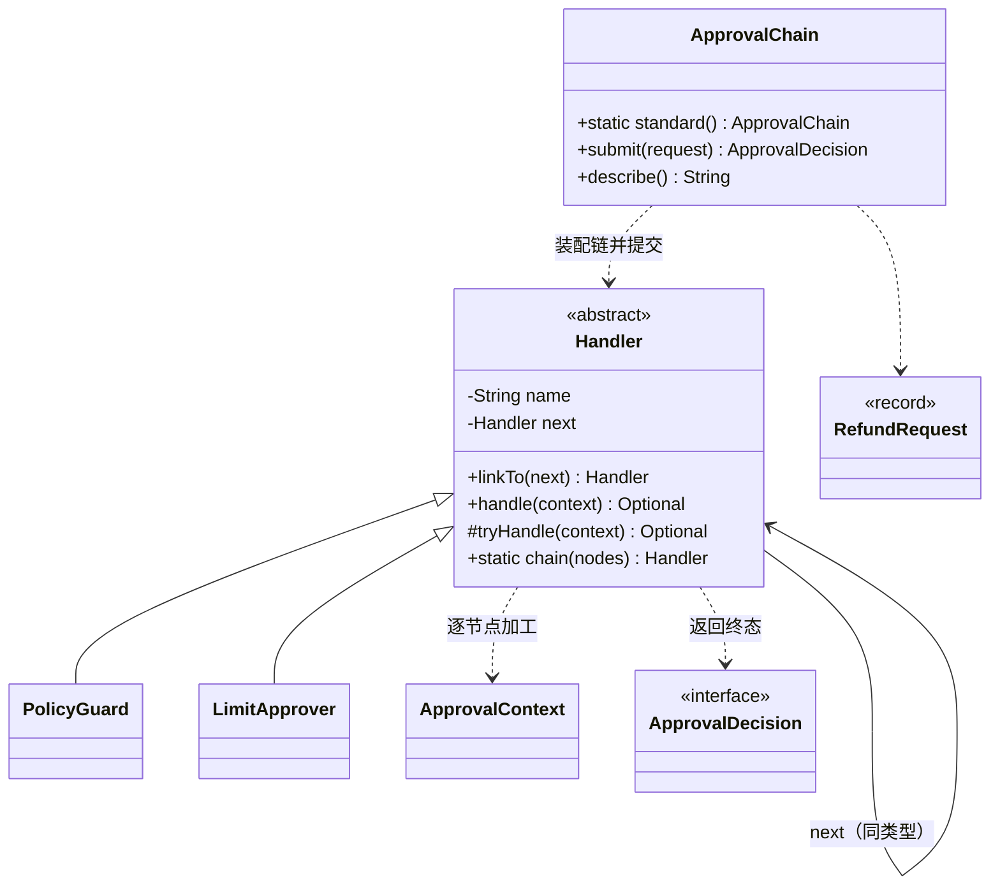

- **谁创建**：`ApprovalChain.standard()` 按顺序 `linkTo()` 串链
- **谁持有**：每个 `Handler` 持有下一个 `Handler`
- **谁控制流程**：`handle()` 是 `final`（骨架），子类只实现 `tryHandle()`；`Optional.empty()` 表示「我不管，交给下一个」
- **变化点**：加一个审批节点 = 新增 `Handler` 子类 + 在装配处插一行，**已有节点一个都不改**

> 关键的工程细节在 `handle()` 被声明成 `final`：链的推进逻辑（调用自己 → 若空则转 `next`）只写一遍，子类想绕过都绕不过去。这和模板方法是同一个手法：**用 final 锁住骨架**。
>
> 另外：同包的 `discount/DiscountPipeline` **不是责任链**。它把所有规则都跑一遍并累加结果，中间不停；责任链的语义是「有人处理就停」。名字相近，语义相反，代码里刻意分了两个包。

### 14. 命令 Command

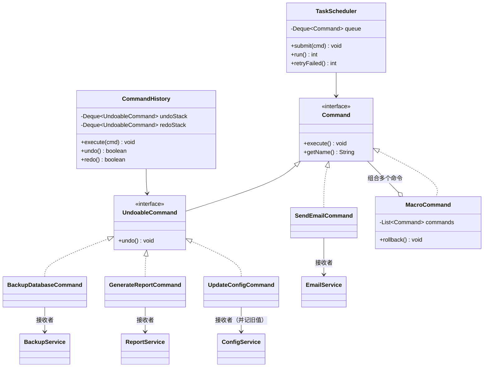

- **谁创建**：调用方创建命令对象，构造时注入接收者与参数
- **谁持有**：`CommandHistory` 持两个栈，`TaskScheduler` 持队列，`MacroCommand` 持命令列表
- **谁控制流程**：调用方不再直接调 service，而是 `history.execute(cmd)` 或 `scheduler.submit(cmd)`，由它们决定何时执行
- **变化点**：加一个操作 = 新增一个 `Command` 实现；**撤销/排队/重试**这些能力集中在持有方，不用每个 service 各写一遍

> 图里能看出命令模式的两层价值：左边是把「一次调用」变成对象（可以传、可以存、可以排队），右边是让**接收者**（各种 Service）完全不知道调用方是谁。`MacroCommand` 用的是 `rollback()` 而不是 `undo()`——批量操作失败时是**逆序补偿**，不是逐个撤销，这两个语义在 [command/README.md](../src/com/patterns/behavioral/command/README.md) §8 有专门区分。

### 15. 解释器 Interpreter

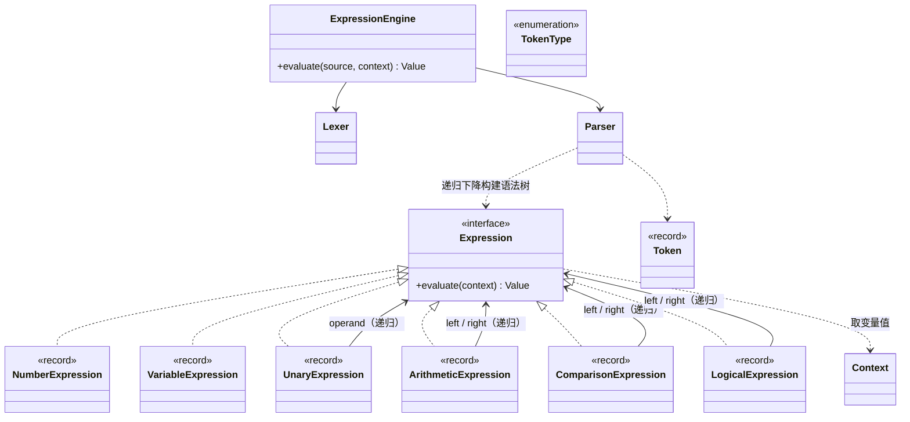

- **谁创建**：`Parser`（递归下降）创建整棵表达式树
- **谁持有**：每个复合表达式持有子表达式（树形递归）
- **谁控制流程**：`engine.evaluate(source)` → `Lexer` 切词 → `Parser` 建树 → `root.evaluate(ctx)` 自顶向下递归
- **变化点**：加一条文法规则 = 新增一个 `Expression` 实现 + 在 `Parser` 里加一个产生式；**求值逻辑分散在各节点里，新增规则不改老节点**

> 这是 23 个模式里最像「编译器前端」的一个：图里 `Lexer` / `Parser` / `Token` 都不是 GoF 解释器的一部分，但没有它们，解释器就只能处理硬编码的对象树。本项目把它们一起放进来，是因为真实的表达式求值一定包含「文本 → 语法树」这一步。
>
> `Expression` 是 `sealed` 的：谁实现了它，编译器全部知道。好处是 `switch` 能穷尽检查，坏处是**加新节点必须改所有 `switch`**——这个代价在 [interpreter/README.md](../src/com/patterns/behavioral/interpreter/README.md) §8 有完整讨论。

### 16. 迭代器 Iterator

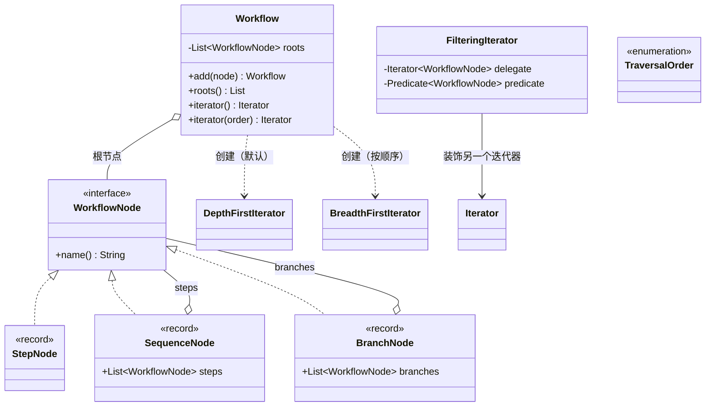

- **谁创建**：`Workflow` 创建具体迭代器（`DepthFirst` / `BreadthFirst`）
- **谁持有**：迭代器持有遍历游标（栈或队列）；`FilteringIterator` 持有另一个迭代器
- **谁控制流程**：`for (var n : workflow)` → `hasNext()` / `next()`，遍历算法全在迭代器里
- **变化点**：加一种遍历顺序 = 新增一个 `Iterator` 实现；**`Workflow` 的内部结构（List）不需要对外暴露**

> `Workflow`、`SequenceNode`、`BranchNode` 三者都持有一组子节点，所以都用 `o--`——和组合模式里的 `Directory o-- FileSystemNode` 是同一个形状。子节点由调用方创建、可以只挂在树上而不被任何容器独占，所以不是 `*--`；而迭代器本身不算「内容」，所以 `Workflow ..> DepthFirstIterator` 才是依赖。

> `FilteringIterator` 是「迭代器装饰迭代器」：它不改变遍历顺序，只过滤元素。这个写法在 JDK 里对应 `Stream.filter()` 的惰性求值——图里 `delegate` 那条线就是「包一层」。
>
> 图里没画的是 `expectedModCount` 的 fail-fast 检查：`Workflow` 在结构变化时改 `modCount`，迭代器每次 `next()` 比对，防止「遍历时增删」这种静默错误。

### 17. 中介者 Mediator

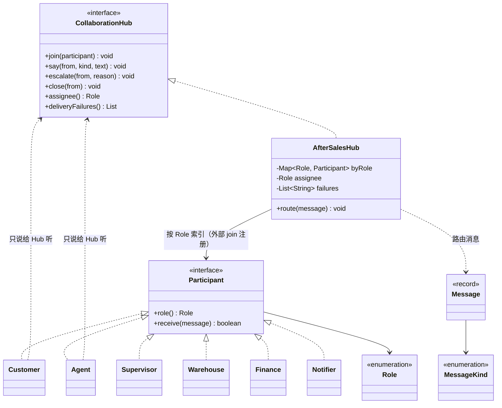

- **谁创建**：调用方创建 Hub 与各参与者，再 `hub.join(p)` 注册
- **谁持有**：`AfterSalesHub` 持有所有参与者的 `Map<Role, Participant>`
- **谁控制流程**：`customer.say(...)` → `hub.say(...)` → 按 `Role` 查表 → `participant.receive(...)`
- **变化点**：加一个角色 = 新增 `Participant` 实现 + 注册；**参与者之间不新增任何引用**

> 图里最重要的一点：**没有任何一条箭头从 `Customer` 指向 `Agent`**。所有跨角色通信都绕经 Hub。这就是中介者与观察者的形状差别——观察者是「主题 → 多个订阅者」的单向广播，中介者是「多对多 → 星形」。
>
> `Notifier` 也是一个 `Participant`（`Role.NOTIFIER`），意味着「发通知」这件事也被收进了 Hub 的路由表里，而不是散落在各个参与者内部。

### 18. 备忘录 Memento

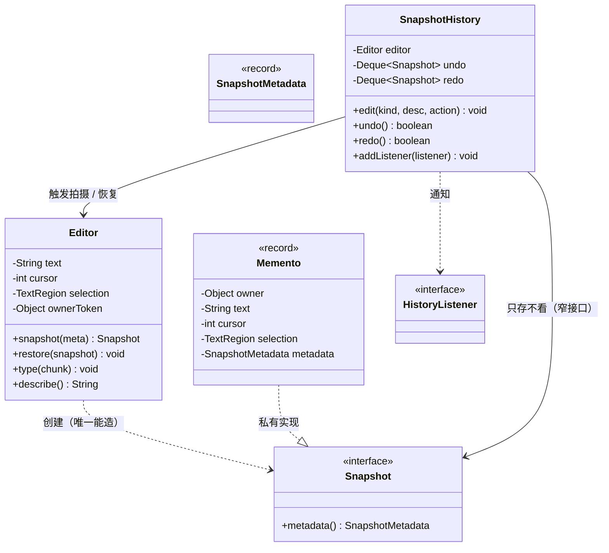

- **谁创建**：`Editor.snapshot()`（originator 自己造快照）
- **谁持有**：`SnapshotHistory` 持两个 `Deque<Snapshot>`（caretaker，只负责存取）
- **谁控制流程**：`history.edit(kind, desc, action)` → 先拍照 → 执行 action → 记录到 undo 栈
- **变化点**：给编辑器加一个字段 = 只改 `Editor` 与私有 `Memento`，**caretaker 与调用方零改动**

> 三个角色的边界全在可见性上：
> - `Snapshot` 是**窄接口**，只有 `metadata()`——caretaker 拿得到对象，读不到正文；
> - `Memento` 是 `private record`，只有 `Editor` 能构造；
> - `ownerToken` 用引用相等校验「这份快照是不是我拍的」，防止 A 的快照被 restore 到 B 上。
>
> 这三条加起来才是备忘录模式。只画 `Editor` / `Snapshot` / `SnapshotHistory` 三个框，看不出它为什么比「存一个 String」更值钱。

### 19. 观察者 Observer

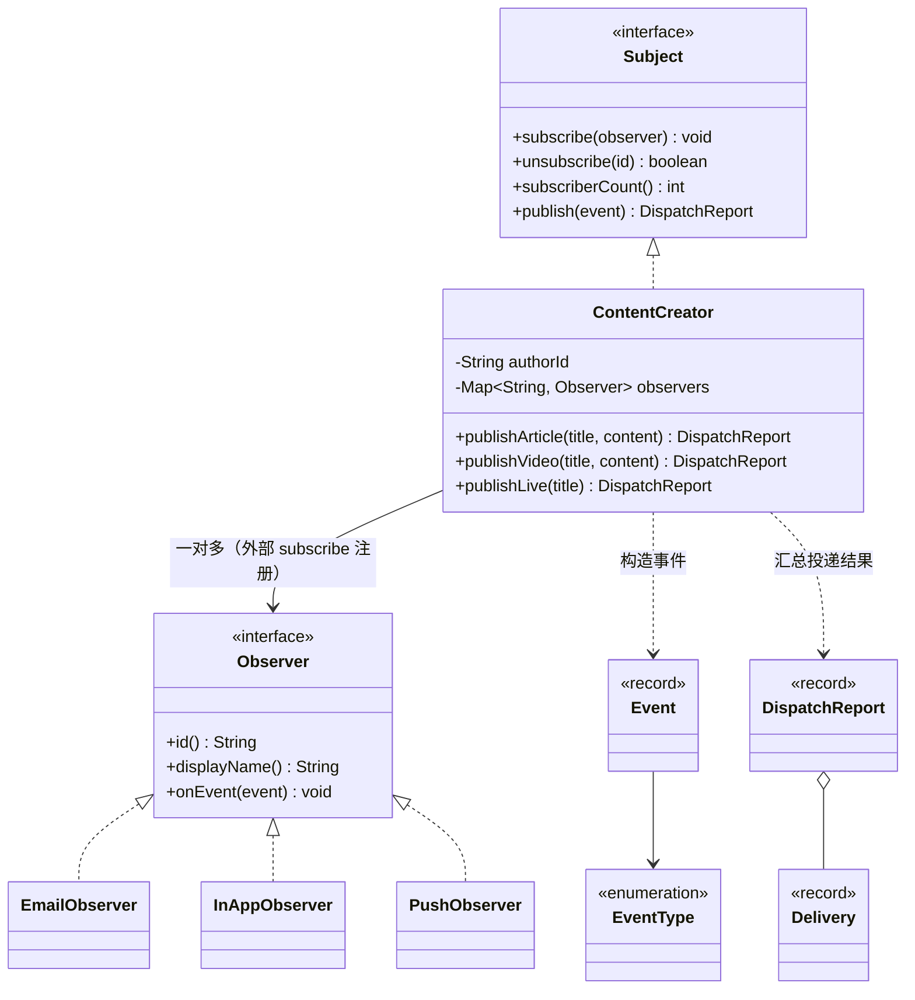

- **谁创建**：订阅方创建观察者实例，`subject.subscribe(o)` 注册
- **谁持有**：`ContentCreator` 持 `Map<String, Observer>`（用 `LinkedHashMap` 保证通知顺序稳定）
- **谁控制流程**：`publishArticle()` → 构造 `Event` → 遍历观察者 `onEvent()` → 汇总 `DispatchReport`
- **变化点**：加一个通知渠道 = 新增 `Observer` 实现；**主题类不改**

> 用 `Map` 而不是 `List` 是一个真实工程决定：同一个人可能用两个账号关注同一个作者，`List` 会发出两条，`Map` 以 `id()` 为键天然去重。图里用的是关联（`-->`）而不是聚合：观察者由外部通过 `subscribe()` 注册，主题不负责它们的创建与销毁，**订阅关系只在运行时成立**。

### 20. 状态 State

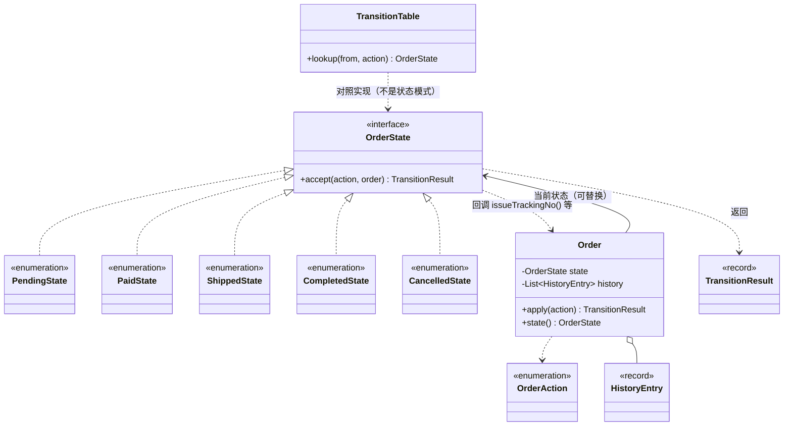

- **谁创建**：状态是 `enum` 单例（`PendingState.INSTANCE`），不需要创建
- **谁持有**：`Order` 持有当前 `OrderState`
- **谁控制流程**：`order.apply(action)` → 委派给 `state.accept(action, order)` → 返回 `TransitionResult`（含「是否换了状态、新状态是什么」）
- **变化点**：加一个状态 = 新增 `enum` 实现 + 在相关状态的 `switch` 里补分支；**加一个动作 = 每个状态都要表态**

> `TransitionTable` 是刻意放在同一个包里的**反例**：它用一张查表处理同样的流转，代码更短、规则一眼可见，但表达不了「不同状态下同一动作含义不同」（比如 `PAY` 在待支付是付款，在已支付是重复支付）。什么时候该用状态模式、什么时候一张表就够，[state/README.md](../src/com/patterns/behavioral/state/README.md) §7 有逐项对比。
>
> `accept()` 里会回调 `order.issueTrackingNo()` 生成发货单号——**状态决定「做什么」，订单决定「编号怎么发」**。这条边界不分清，状态类就会慢慢长成一个 God Object。
>
> `Order.state` 画的是 `-->` 而不是 `*--`：五个状态都是 `enum` 的单例实例（`PendingState.INSTANCE`），**在类初始化时创建了唯一一份、被所有订单共享**。订单没有创建它们，也不会销毁它们 —— 这正是 §0.1.2 说的「静态字段引用」，不是对象组合。

### 21. 策略 Strategy

```mermaid
classDiagram
    class DiscountStrategy {
        <<interface>>
        +name() String
        +apply(price) BigDecimal
        +static requireValidPrice(price) void
        +static normalize(value) BigDecimal
    }
    class NoDiscountStrategy
    class PercentageDiscountStrategy
    class FullReductionStrategy
    class VipDiscountStrategy
    class SimpleDiscountStrategy {
        <<record>>
    }
    class PriceCalculator {
        -DiscountStrategy strategy
        +withStrategy(next) PriceCalculator
        +calculate(price) BigDecimal
    }
    class DiscountStrategyFactory {
        +static forLevel(level) DiscountStrategy
    }
    class UserLevel {
        <<enumeration>>
    }
    DiscountStrategy <|.. NoDiscountStrategy
    DiscountStrategy <|.. PercentageDiscountStrategy
    DiscountStrategy <|.. FullReductionStrategy
    DiscountStrategy <|.. VipDiscountStrategy
    DiscountStrategy <|.. SimpleDiscountStrategy
    PriceCalculator --> DiscountStrategy : final 字段
    DiscountStrategyFactory ..> DiscountStrategy : 创建
    DiscountStrategyFactory ..> UserLevel
```

- **谁创建**：`DiscountStrategyFactory`（按用户等级）或调用方直接 `new`
- **谁持有**：`PriceCalculator` 持有 `final DiscountStrategy strategy`
- **谁控制流程**：`calculator.calculate(price)` → `strategy.apply(price)`，计算器不关心用哪个算法
- **变化点**：加一种折扣 = 新增 `DiscountStrategy` 实现，`PriceCalculator` 零改动

> `PriceCalculator` 是**不可变**的：`withStrategy()` 返回新对象，而不是改自己的字段。这条设计让「同一个计算器被两个线程用不同策略调用」这种事故不可能发生——图里 `final` 那两个字是它的全部保证。
>
> `requireValidPrice()` / `normalize()` 是接口里的 `static` 方法，不是抽象基类。**为了复用一行校验去抽一个 `AbstractDiscountStrategy`，是策略模式最常见的过度设计。**

### 22. 模板方法 Template Method

```mermaid
classDiagram
    class OrderProcessTemplate {
        <<abstract>>
        +processOrder(context) void
        #checkStock(context) void
        #pay(context) void
        #deliver(context) void
        #notifyCustomer(context) void
        #needsStockCheck() boolean
        #deliveryProofLabel() String
        #generateSerialNo(prefix) String
    }
    class PhysicalProductOrder
    class VirtualProductOrder
    class PreSaleOrder
    class OrderContext
    OrderProcessTemplate <|-- PhysicalProductOrder
    OrderProcessTemplate <|-- VirtualProductOrder
    OrderProcessTemplate <|-- PreSaleOrder
    OrderProcessTemplate ..> OrderContext : 全程传递
```

- **谁创建**：调用方创建具体子类
- **谁持有**：没有持有关系——这是全篇唯一一个**不靠组合**的行为型模式
- **谁控制流程**：`processOrder()` 是 `public final`，顺序写死在父类；子类只能填 `pay()` / `deliver()`
- **变化点**：加一种订单类型 = 新增一个子类；**流程顺序要变 = 只能改父类（这是刻意的）**

> 图里 `processOrder` 加粗成 `+`，其余步骤是 `#`（`protected`）——这组可见性就是模式的全部契约：**外部只能启动流程，子类只能填步骤，谁都不能改顺序**。
>
> 三个钩子（`needsStockCheck` / `deliveryProofLabel` / `beforePay`）是「可选步骤」的写法：给一个默认实现，子类想改才覆盖。没有钩子，所有子类都得实现一遍空方法。

### 23. 访问者 Visitor

```mermaid
classDiagram
    class Document {
        <<interface>>
        +accept(visitor) R
    }
    class PdfDocument {
        <<record>>
    }
    class WordDocument {
        <<record>>
    }
    class SpreadsheetDocument {
        <<record>>
    }
    class DocumentVisitor {
        <<interface>>
        +visitPdf(doc) R
        +visitWord(doc) R
        +visitSheet(doc) R
    }
    class HtmlExportVisitor
    class PlainTextVisitor
    class StatisticsVisitor
    class DocumentBundle {
        -List~Document~ documents
        +add(doc) void
        +accept(visitor) List
    }
    Document <|.. PdfDocument
    Document <|.. WordDocument
    Document <|.. SpreadsheetDocument
    Document ..> DocumentVisitor : accept 是第一跳
    DocumentVisitor <|.. HtmlExportVisitor
    DocumentVisitor <|.. PlainTextVisitor
    DocumentVisitor <|.. StatisticsVisitor
    DocumentBundle o-- Document
```

- **谁创建**：调用方创建访问者，传给 `document.accept(visitor)`
- **谁持有**：`DocumentBundle` 持文档集合；访问者通常**无状态**（每次 new 一个）
- **谁控制流程**：`doc.accept(v)` → `v.visitPdf(this)` → 访问者拿到具体类型。**两次分派**：第一次按文档类型，第二次按访问者类型
- **变化点**：加一种**操作** = 新增 `DocumentVisitor` 实现，元素类零改动；加一种**文档类型** = 改 `DocumentVisitor` 接口 + 所有访问者（代价在这一侧）

> 访问者是「用继承换扩展方向」的典型：`sealed interface Document` 让新增文档类型必须改所有访问者，换来的是新增操作极其便宜。**如果你的需求里文档类型经常加、操作很少变，访问者就是错的模式**——这一点在 [visitor/README.md](../src/com/patterns/behavioral/visitor/README.md) §7 讲得比这里细。
>
> 同包的 `pricing/` 是第二套示例（购物车 + 三种计价访问者），形状一模一样，只是元素从「文档」换成「商品」。两套示例放在一起是为了说明：**访问者的结构跟业务无关，只跟「元素稳定、操作多变」这个前提有关。**

---

## 四、组合案例

### 24. orderservice：策略 + 装饰器 + 责任链 + 工厂

```mermaid
classDiagram
    class DiscountPolicy {
        <<interface>>
        +name() String
        +discount(price, context) BigDecimal
    }
    class PercentagePolicy
    class FullReductionPolicy
    class PointsDeductionPolicy
    class CappedPolicy {
        -DiscountPolicy delegate
    }
    class TracePolicy {
        -DiscountPolicy delegate
    }
    class Requirement {
        <<interface>>
        +test(context) boolean
        +describe() String
    }
    class DiscountHandler {
        <<abstract>>
        -String name
        -DiscountHandler next
        +linkTo(next) DiscountHandler
        +process(state, context) void
        #decide(price, context, state) DiscountDecision
    }
    class PolicyHandler {
        -DiscountPolicy policy
        -Requirement requirement
    }
    class ExclusiveGroupHandler {
        -String groupName
    }
    class DiscountPipeline {
        -DiscountHandler head
        +calculate(context) DiscountResult
    }
    class ChainState
    class AuditTrail
    class OrderContext
    class DiscountResult {
        <<record>>
    }
    class PolicyFactory {
        +static create(spec) DiscountPolicy
    }
    class PipelineFactory {
        +static builder() Builder
    }
    DiscountPolicy <|.. PercentagePolicy
    DiscountPolicy <|.. FullReductionPolicy
    DiscountPolicy <|.. PointsDeductionPolicy
    DiscountPolicy <|.. CappedPolicy
    DiscountPolicy <|.. TracePolicy
    CappedPolicy --> DiscountPolicy : 装饰
    TracePolicy --> DiscountPolicy : 装饰
    DiscountHandler <|-- PolicyHandler
    DiscountHandler <|-- ExclusiveGroupHandler
    DiscountHandler --> DiscountHandler : next
    PolicyHandler --> DiscountPolicy : 持有策略
    PolicyHandler --> Requirement : 持有条件
    DiscountPipeline --> DiscountHandler : 链头
    PipelineFactory ..> DiscountPipeline : 装配
    PipelineFactory ..> PolicyFactory : 委托创建
    PolicyFactory ..> DiscountPolicy : 创建
    DiscountHandler ..> ChainState : 累加
    DiscountHandler ..> AuditTrail : 记账
    DiscountPipeline ..> OrderContext
    DiscountPipeline ..> DiscountResult
```

**四个模式的接缝在哪**：

| 接缝 | 谁连谁 | 为什么必须分开 |
|---|---|---|
| 策略 ↔ 责任链 | `PolicyHandler` 持有 `DiscountPolicy` | 链负责「按什么顺序问」，策略负责「怎么算」。合在一起，加一种优惠就要动链的结构 |
| 装饰器 ↔ 策略 | `CappedPolicy` / `TracePolicy` 包住另一个 `DiscountPolicy` | 封顶和追踪是**横切**关注点，不属于任何一个算法。写进策略里，每个策略都要复制一遍 |
| 条件 ↔ 策略 | `PolicyHandler` 同时持有 `Requirement` | 「满 100 才能用」是条件，「减 20」是算法。合在一起，同一个算法换个门槛就要新建一个类 |
| 工厂 ↔ 全部 | `PolicyFactory` 造策略，`PipelineFactory` 装配链 | 前者解决「字符串 → 对象」，后者解决「对象 → 有序链」。合成一个超级工厂，两个变化轴就缠死了 |

**一次计算的执行顺序**（以「满减 → 折扣券 → 积分 → 封顶 → 追踪」为例）：

```mermaid
sequenceDiagram
    participant C as Client
    participant P as DiscountPipeline
    participant H1 as PolicyHandler(满减)
    participant H2 as ExclusiveGroupHandler(券)
    participant H3 as PolicyHandler(积分)
    participant Cap as CappedPolicy
    participant S as ChainState
    participant A as AuditTrail
    C->>P: calculate(orderContext)
    P->>H1: process(state, context)
    H1->>S: reduction() 取当前已减金额
    H1->>H1: policy.discount(price, context)
    H1->>A: record(策略名, 减免额, 是否生效)
    H1->>H2: next.process(...)
    H2->>S: 该优惠组是否已被占用
    alt 组未占用
        H2->>H3: next.process(...)
    else 组已占用
        H2->>A: record(跳过原因)
        H2->>H3: next.process(...)
    end
    H3->>Cap: 策略内部已套好装饰器
    Cap->>S: 当前减免额
    Cap-->>H3: min(减免额, 封顶值)
    H3->>A: record(...)
    A-->>P: 账本
    P-->>C: DiscountResult(原价, 终价, 明细)
```

> 注意 `CappedPolicy` 是在**策略层**被调用的（`PolicyHandler.decide()` 里），不是链上的一环。这是本项目最容易看错的一处：封顶是「策略的装饰器」，不是「链的节点」。

### 25. apigateway：责任链 + 策略 + 装饰器 + 状态 + 观察者 + 享元

```mermaid
classDiagram
    class Gateway {
        -RouteTable routeTable
        -LoadBalancer balancer
        -FilterChain filterChain
        -List~GatewayListener~ listeners
        +handle(request) GatewayResponse
    }
    class FilterChain {
        -List~GatewayFilter~ filters
        -UpstreamHandler terminal
        +newCall(request) Cursor
    }
    class Cursor {
        +proceed() GatewayResponse
        +context() CallContext
    }
    class GatewayFilter {
        <<abstract>>
        +name() String
        +handle(context, next) GatewayResponse
    }
    class AuthFilter
    class RateLimitFilter
    class RouterFilter {
        -RouteTable routeTable
        -LoadBalancer balancer
    }
    class CacheFilter
    class UpstreamHandler {
        <<interface>>
        +handle(context) GatewayResponse
    }
    class MetricsHandler
    class RetryHandler
    class CircuitBreakerHandler {
        -CircuitBreaker breaker
    }
    class ServiceHandler
    class CircuitBreaker {
        +tryPass() boolean
        +onSuccess() void
        +onFailure() void
    }
    class LoadBalancer {
        <<interface>>
        +pick(instances) UpstreamInstance
    }
    class RouteTable {
        -Map~String, RouteConfig~ routes
    }
    class GatewayListener {
        <<interface>>
    }
    class CallContext {
        <<record>>
    }
    Gateway --> FilterChain
    Gateway --> RouteTable
    Gateway --> LoadBalancer
    FilterChain o-- GatewayFilter : 过滤器链
    FilterChain --> UpstreamHandler : 终端处理器
    GatewayFilter --> Cursor : 调 next.proceed()
    GatewayFilter <|-- AuthFilter
    GatewayFilter <|-- RateLimitFilter
    GatewayFilter <|-- RouterFilter
    GatewayFilter <|-- CacheFilter
    UpstreamHandler <|.. MetricsHandler
    UpstreamHandler <|.. RetryHandler
    UpstreamHandler <|.. CircuitBreakerHandler
    UpstreamHandler <|.. ServiceHandler
    MetricsHandler --> UpstreamHandler : 装饰
    RetryHandler --> UpstreamHandler : 装饰
    CircuitBreakerHandler --> UpstreamHandler : 装饰
    CircuitBreakerHandler --> CircuitBreaker : 状态机
    ServiceHandler ..> UpstreamInstance
    RouterFilter --> RouteTable
    RouterFilter --> LoadBalancer
    RouteTable --> UpstreamInstance : 享元池（共享实例，不拥有生命周期）
    Gateway ..> GatewayListener : 通知
    LoadBalancer ..> UpstreamInstance
```

**六个模式的接缝在哪**：

| 接缝 | 谁连谁 | 分工 |
|---|---|---|
| 责任链 ↔ 终端处理器 | `FilterChain.filters` → `UpstreamHandler terminal` | 前半段是「进来的请求怎么处理」，后半段是「出去调上游怎么调」。两段变化轴不同，硬塞成一条链会让过滤器被迫懂网络 |
| 装饰器栈 | `Metrics(Retry(Breaker(Service)))` | 四层都实现同一个 `UpstreamHandler`，由内向外包裹。顺序即语义：重试包在熔断外面，才能「熔断拒绝 → 换实例重试」 |
| 状态 ↔ 装饰器 | `CircuitBreakerHandler` 持有 `CircuitBreaker` | 熔断器自己的 Closed/Open/HalfOpen 是状态模式；它在装饰器里只是一个被查询的判断 |
| 策略 ↔ 路由 | `RouterFilter` 持有 `LoadBalancer` | 「去哪台机器」是可替换算法，「怎么找到路由」是过滤器职责 |
| 享元 ↔ 路由 | `RouteTable` 持有 `Map<String, RouteConfig>` | 路由配置按 key 共享，不随请求复制 |
| 观察者 ↔ 网关 | `Gateway.listeners` | 请求结束后广播指标/告警，网关主体不认识具体监听器 |

**一次请求的完整路径**：

```mermaid
sequenceDiagram
    participant C as Client
    participant G as Gateway
    participant FC as FilterChain
    participant AF as AuthFilter
    participant RF as RouterFilter
    participant CF as CacheFilter
    participant MH as MetricsHandler
    participant RH as RetryHandler
    participant BH as CircuitBreakerHandler
    participant SH as ServiceHandler
    participant L as GatewayListener
    C->>G: handle(request)
    G->>FC: newCall(request)
    FC->>AF: handle(ctx, next)
    AF->>AF: 校验 token
    AF->>RF: next.proceed()
    RF->>RF: 查路由 + 选实例（策略）
    RF->>CF: next.proceed()
    alt 命中缓存
        CF-->>G: 直接返回
    else 未命中
        CF->>MH: next.proceed()
        MH->>RH: next.proceed()
        RH->>BH: next.proceed()
        BH->>BH: breaker.tryPass()
        alt breaker 放行
            BH->>SH: next.handle(ctx)
            SH-->>BH: response
            BH->>BH: onSuccess()
        else breaker 熔断
            BH-->>RH: 503
            RH->>RH: 换实例重试
        end
        RH-->>MH: response
        MH->>MH: 记录耗时
        MH-->>CF: response
        CF->>CF: 写入缓存
        CF-->>RF: response
    end
    RF-->>AF: response
    AF-->>G: response
    G->>L: onRequest(...)
    G-->>C: GatewayResponse + CallContext
```

> 这张时序图只画了 4 个过滤器、4 层装饰器。真实网关的过滤器更多，但**形状不会变**：过滤器按 `List` 顺序进、按栈顺序出；装饰器从内到外包。看懂这 8 个参与者，加多少个都不慌。

---

## 附录 A：图与代码对照索引

| # | 模式 | 图里的核心类 | 源码目录 |
|---|---|---|---|
| 1 | 单例 | `EagerSingleton` / `DoubleCheckLockSingleton` / `EnumSingleton` | `creational/singleton/` |
| 2 | 工厂方法 | `MessageFactory` / `NotificationService` | `creational/factorymethod/` |
| 3 | 抽象工厂 | `UIFactory` / `Button` / `TextBox` / `Image` | `creational/abstractfactory/` |
| 4 | 建造者 | `Computer.Builder` / `ComputerBuilder` / `Director` | `creational/builder/` |
| 5 | 原型 | `DocumentPrototype` / `DocumentRegistry` | `creational/prototype/` |
| 6 | 适配器 | `AudioPlayer` / `MediaAdapter` / `AdvancedMediaPlayer` | `structural/adapter/` |
| 7 | 桥接 | `Message` / `MessageSender` | `structural/bridge/` |
| 8 | 组合 | `FileSystemNode` / `Directory` / `FileLeaf` | `structural/composite/` |
| 9 | 装饰器 | `TextComponent` / `TextDecorator` | `structural/decorator/` |
| 10 | 外观 | `UserServiceFacade` + 4 个子系统 | `structural/facade/` |
| 11 | 享元 | `GlyphFactory` / `CharacterGlyph` / `CharacterView` | `structural/flyweight/` |
| 12 | 代理 | `Image` / 4 个静态代理 / `ImageInvocationHandler` | `structural/proxy/` |
| 13 | 责任链 | `Handler` / `ApprovalChain` | `behavioral/chainofresponsibility/` |
| 14 | 命令 | `Command` / `CommandHistory` / `TaskScheduler` | `behavioral/command/` |
| 15 | 解释器 | `Expression` / `Parser` / `ExpressionEngine` | `behavioral/interpreter/` |
| 16 | 迭代器 | `Workflow` / `DepthFirstIterator` / `FilteringIterator` | `behavioral/iterator/` |
| 17 | 中介者 | `CollaborationHub` / `AfterSalesHub` / `Participant` | `behavioral/mediator/` |
| 18 | 备忘录 | `Editor` / `Snapshot` / `SnapshotHistory` | `behavioral/memento/` |
| 19 | 观察者 | `Subject` / `Observer` / `ContentCreator` | `behavioral/observer/` |
| 20 | 状态 | `OrderState` / `Order` / `TransitionTable` | `behavioral/state/` |
| 21 | 策略 | `DiscountStrategy` / `PriceCalculator` | `behavioral/strategy/` |
| 22 | 模板方法 | `OrderProcessTemplate` + 3 个子类 | `behavioral/templatemethod/` |
| 23 | 访问者 | `Document` / `DocumentVisitor` | `behavioral/visitor/` |
| 24 | 组合案例 | `DiscountPipeline` / `PolicyFactory` / `PipelineFactory` | `combined/orderservice/` |
| 25 | 组合案例 | `Gateway` / `FilterChain` / `UpstreamHandler` | `combined/apigateway/` |

## 附录 B：画图时会踩的三个坑

1. **别把「实现接口」画成「继承」**。`<|..` 是虚线，`<|--` 是实线。装饰器与适配器全靠这个区别，画错就分不清两者。
2. **别省略「谁创建」**。`..>` 依赖箭头最好带上 `: 创建` 标签，否则「工厂」和「策略持有者」看起来一模一样。
3. **别给每个类都画全字段和方法**。一张图超过 12 个类，读者就开始数框框而不是看关系。要细节就单独画一张，或者直接读源码。

---

相关文档：[02 模式对比](02-pattern-comparison.md) · [07 组合与继承](07-composition-vs-inheritance.md) · [pattern-selection-guide.md](pattern-selection-guide.md) · [01 学习路径](01-learning-path.md)
