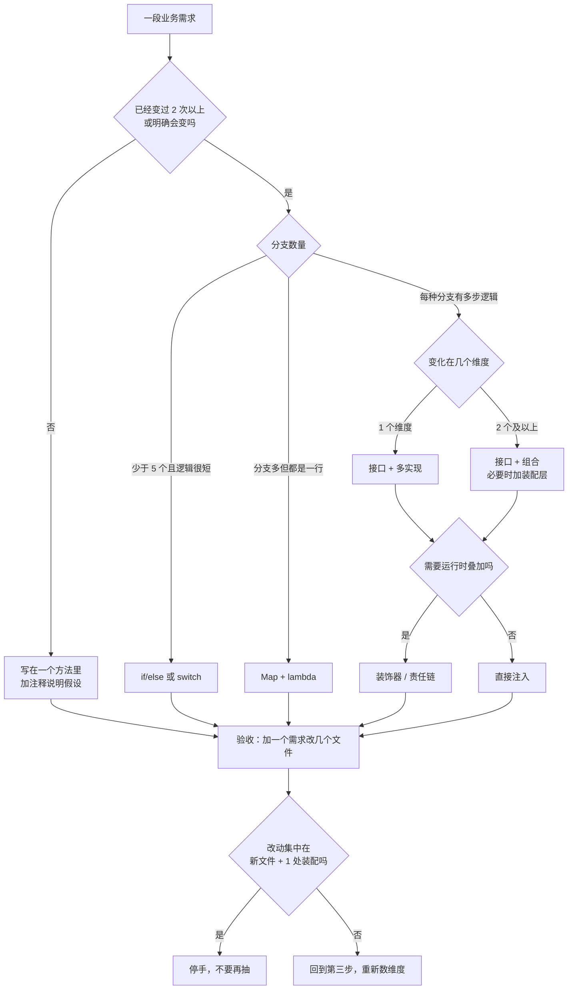
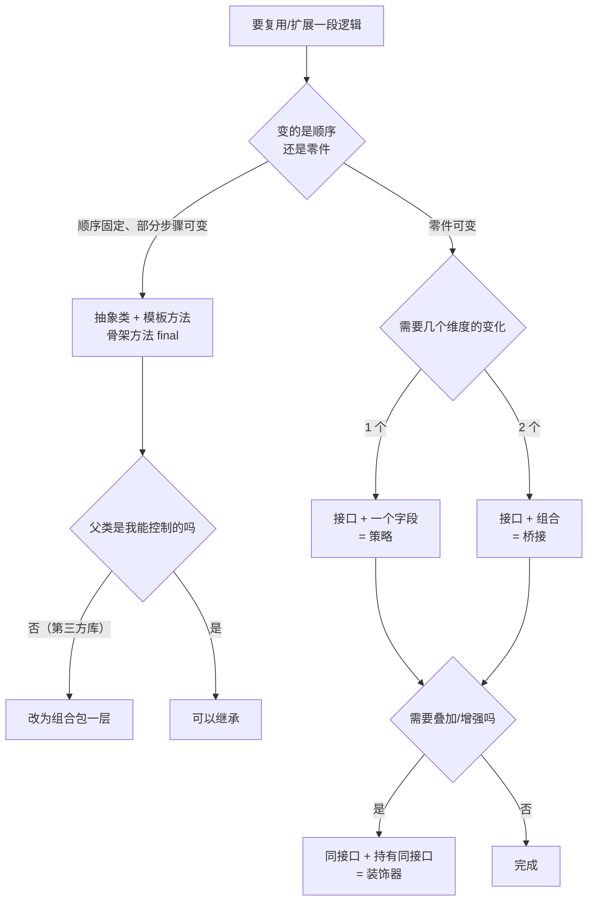
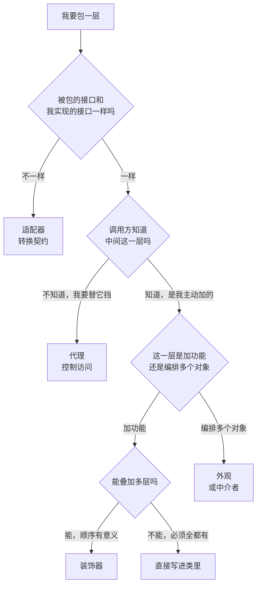

# 设计模式选择指南：从业务需求推导到设计方案

> 这篇文档不教「模式是什么」——那是 23 份 `README.md` 的活。
> 它只解决一个问题：**面对一段业务需求，你怎么一步步走到「这里该抽一个接口」「这里该装一个对象进来」「这里其实什么都不用动」。**
>
> 结论先行：**先找变化点，再定职责，最后才挑模式。挑不出模式是常态，挑错了才是灾难。**
>
> **配套阅读**：[docs 导航](README.md) ｜ [相似模式对比](02-pattern-comparison.md)（定义差异） ｜ [组合与继承](07-composition-vs-inheritance.md)（机制分类） ｜ [UML 图谱](10-uml-atlas.md)（图上的区别） ｜ [综合练习](practice/README.md)（拿五道题练手）

---

## 0. 先破除三个误区

### 0.1 模式不是设计起点，是设计结果

新手最常问的是「这里该用哪个模式」。这个问题问反了。

正确的顺序是：

```
业务需求 → 哪里会变 → 谁该负责 → 用什么机制隔离变化 → 最后发现：这个结构有名字，叫策略
```

先选模式再找场景，结果一定是「为了用模式而增加类」。判断方法很简单：**如果把这个模式的名字从代码里删掉，设计还站得住吗？** 站得住，说明你是按需求设计的；站不住，说明你是在套模板。

### 0.2 「用了模式」不等于「设计好」

一个项目用了 12 种模式，可能是设计得好，也可能是灾难。模式只描述结构，不评价合理性。真正的评价标准只有一条：

> **需求变化时，需要改几个文件？改的地方是不是「本该改的地方」？**

如果加一种优惠券要改 8 个文件，其中 5 个是跟优惠券无关的，那不管用了多少模式，这个设计都是坏的。

### 0.3 抽象有成本，而且成本不在写的时候

抽象的成本清单（每一条都在本项目里真实出现过）：

| 成本 | 具体表现 |
|---|---|
| 多一层跳转 | 读代码要跨 3 个文件才能拼出一条完整逻辑 |
| 多一批类型 | IDE 里 `DiscountPolicy` 有 5 个实现，新人不知道从哪个看起 |
| 多一处装配 | `new` 从业务代码挪到了工厂，工厂本身也要维护 |
| 多一个出错点 | 反射/配置/字符串 key 都是运行时才报错，编译器帮不上 |
| 多一份文档债 | 接口变了，5 个实现 + 3 篇文档都要跟着改 |

所以本文的默认立场是：**能不抽象就不抽象，等到变化真的发生，再付这笔钱。**

---

## 1. 六步推导法

这是本文的主线，后面所有章节都是它的展开。

| 步骤 | 要回答的问题 | 产出 | 常见错误 |
|---|---|---|---|
| 1 | 需求里有几件事会变？ | 一张变化清单 | 把「可能要变」当「一定会变」 |
| 2 | 每条变化影响哪些代码？ | 影响面清单 | 只看当前代码，不看调用方 |
| 3 | 变化属于哪个维度？ | 维度列表 | 把两个维度混成一个 |
| 4 | 谁创建、谁持有、谁调用、谁记录？ | 职责表 | 让一个类同时负责创建和执行 |
| 5 | 用最轻的机制能不能解决？ | 机制选择 | 一步跳到「接口 + 组合」 |
| 6 | 加一个需求要改几个文件？ | 验收结论 | 只看能不能跑，不看改动面 |

### 1.1 第一步：把需求写成「变化清单」

不要写「做一个订单系统」，要写「**哪些东西会以什么频率变**」。

以本项目的订单折扣为例：

| 会变的东西 | 变化频率 | 变化来源 |
|---|---|---|
| 有哪些优惠类型 | 高（每月新增） | 运营活动 |
| 每种优惠的算法 | 低 | 业务规则 |
| 优惠的使用门槛 | 高 | 运营活动 |
| 优惠之间的互斥关系 | 中 | 运营策略 |
| 计算结果的展示 | 中 | 前端需求 |
| 订单本身的字段 | 低 | 商品模型 |

**频率决定隔离强度**：每月新增的东西必须能「加类不改老类」；十年不变的东西写死在方法里完全没问题。

### 1.2 第二步：区分「事实」「规则」「策略」「副作用」

这四类东西的生命周期完全不同，混在一起是耦合的根源。

| 类型 | 例子 | 会不会变 | 该放哪 |
|---|---|---|---|
| 事实 | 订单金额、用户等级、下单时间 | 不会（结构稳定） | 一个不可变的上下文对象（`OrderContext`） |
| 规则 | 满 100 才能用这张券 | 会（门槛经常调） | 独立的条件对象（`Requirement`） |
| 策略 | 满 100 减 20 / 打 9 折 | 会（新增类型） | 独立算法对象（`DiscountPolicy`） |
| 副作用 | 记账、埋点、发通知 | 会（加监控/加审计） | 装饰器或监听器，**不要塞进算法** |

本项目 `orderservice` 的核心设计就是把后三类彻底拆开：`OrderContext`（事实）、`Requirement`（规则）、`DiscountPolicy`（策略）、`AuditTrail`（副作用）。拆开之后，加一种优惠只动策略，加一条门槛只动条件，加一项审计只动账本。

### 1.3 第三步：找变化点，并数清维度

「变化点」不是「可能变的地方」，而是**已经变过、或者明确会变的地方**。

三个判据，满足任意一个才值得隔离：

1. **已经变过两次以上**——历史是最好的证据；
2. **有明确的第二实现**——现在就有两个，不是「以后可能有」；
3. **变化来自不同的人/团队**——运营改优惠、财务改规则、开发改代码，三拨人改同一个文件必然打架。

然后数维度：

| 现象 | 维度数 | 结论 |
|---|---|---|
| 只有「优惠类型」在变 | 1 | 一个接口 + 多个实现就够（策略） |
| 「消息类型」和「发送渠道」都在变 | 2 | 必须组合（桥接），继承会爆炸成乘积 |
| 「订单类型」和「支付方式」都在变 | 2 | 同上 |

**维度 ≥ 2 是组合的硬信号**。这条判断在 [07-composition-vs-inheritance.md](07-composition-vs-inheritance.md) §6 有更详细的推导。

### 1.4 第四步：定职责边界

画 UML 之前先问四个问题，答案就是图上的箭头：

| 问题 | 对应关系 | 本项目例子 |
|---|---|---|
| 谁创建对象？ | `..> : 创建` | `PolicyFactory` 创建 `DiscountPolicy` |
| 谁持有对象？ | `-->` | `PriceCalculator` 持有 `DiscountStrategy` |
| 谁调用谁？ | 时序图 | `DiscountPipeline` → `DiscountHandler` → `DiscountPolicy` |
| 谁记录发生了什么？ | 单独的类 | `AuditTrail` 记录每一步，**算法自己不记账** |

第 4 条最容易被忽略。让策略自己打印日志，等于把「算法」和「可观测性」焊死——想换日志格式就要动所有策略。所以本项目把账本抽成 `AuditTrail`，由链骨架统一写。

### 1.5 第五步：选最轻的机制

按成本从低到高，**能停在前面就停在前面**：

| 层级 | 机制 | 成本 | 什么时候够用 |
|---|---|---|---|
| 0 | 直接写在一个方法里 | 最低 | 只有一种情况，且不会变 |
| 1 | `if/else` 或 `switch` | 很低 | 分支 ≤ 5 个，变化频率低 |
| 2 | 枚举 + `switch` | 低 | 分支固定、由编译器保证穷尽 |
| 3 | `Map<Key, Function>` | 中低 | 分支多但逻辑都是一行 lambda |
| 4 | 接口 + 多个实现 | 中 | 每种实现有独立状态/依赖/多步逻辑 |
| 5 | 接口 + 组合（委托/装饰/链） | 高 | 需要运行时装配、叠加、按序执行 |
| 6 | 元编程/反射/DSL | 最高 | 需要外部配置驱动，且变更不需要重新编译 |

本项目在 23 个模式里的实际落点，大多数停在 4~5。**没有一个模式需要到 6**——`interpreter` 已经是全项目最"重"的，它用的仍然是普通类层次，不是反射。

### 1.6 第六步：验收——加一个需求要改几个文件

这是唯一可靠的验收标准。做法：**假装现在要加第 N+1 个需求，数一下必须改的文件。**

| 结论 | 含义 |
|---|---|
| 只加新文件，不改老文件 | 设计到位（开闭原则达成） |
| 改 1 个装配处 + 加新文件 | 正常，装配本来就该集中 |
| 改 3 个以上老文件 | 抽象层次切错了，或者切少了 |
| 要改所有实现类 | 变化点找错了维度（比如把「操作」抽成了接口，结果操作天天加） |

本项目里可以直接验证的例子：给 `orderservice` 加一种「第二件半价」，只需要新增一个 `DiscountPolicy` 实现 + 在 `PolicyFactory` 注册一行，链、装饰器、结果对象全都不用动。

---

## 2. 什么时候值得抽象？

### 2.1 三条硬指标，至少满足两条

1. **会变**：有历史证据或明确 roadmap，不是「感觉以后会变」；
2. **有多个实现**：现在就有两个以上真实实现，或者一个真实实现 + 一个测试替身；
3. **调用方不该知道细节**：调用方一旦知道具体类型，就会长出 `instanceof` 分支。

三条全不满足，**直接写死**。

### 2.2 什么时候不该抽象

| 场景 | 为什么不该抽象 | 更简单的做法 |
|---|---|---|
| 逻辑十年没变过 | 抽象只产生阅读成本 | 一个 `static` 方法 |
| 只有一个实现，且没有测试替身需求 | 接口是纯负担，改签名还要改两处 | 具体类，需要时再抽 |
| 性能敏感的内层循环 | 多态分派 + 对象分配都是实打实的开销 | 直接计算，必要时用 `switch` |
| 逻辑本身就是「一次性脚本」 | 抽象出来也没人复用 | 一个方法，用完就删 |
| 需求还没想清楚 | 抽象会把错误的理解固化下来 | 先写重复代码，等模式浮现 |

最后一条尤其重要：**重复代码是设计的原材料，不是罪证**。三次重复之后再抽象，比一开始就猜「这里应该有个接口」准确得多（Rule of Three）。

### 2.3 「以后再扩展」是个陷阱

「以后可能要支持多种支付方式」——这句话在 90% 的项目里不会兑现。判断方法：

- 有没有**具体的**第二种支付方式的名字？没有 → 不抽象
- 有没有**排期**？没有 → 不抽象
- 是不是「为了面试/为了显得专业」？是 → 一定不抽象

真正会变的信号长这样：「下个月要接微信支付，接口文档已经给了」。这才是可以动手的依据。

### 2.4 一张判断流程图



图里最容易被忽略的是最后一个判断：**设计是可以「停」的**。抽到接口 + 注入就够了，不需要再套一层工厂，也不需要再套一层门面。

---

## 3. 接口、继承、组合怎么选

### 3.1 三者的成本对照

| | 继承 `extends` | 接口 `implements` | 组合 `has-a` |
|---|---|---|---|
| 耦合强度 | 最强（继承实现细节） | 中（只承诺契约） | 最弱（只知道对方能做什么） |
| 复用方式 | 白盒，直接用父类实现 | 默认方法可复用少量 | 黑盒，委托给对象 |
| 能否多选 | 只能 1 个父类 | 可以多实现 | 想持有几个都行 |
| 运行时能否换 | 不能 | 不能（类型在编译期定） | 能 |
| 变化成本 | 改父类影响所有子类 | 改接口影响所有实现 | 换一个对象即可 |
| 典型用途 | 骨架 + 回调 | 定义能力/角色 | 装配行为 |

### 3.2 决策顺序



### 3.3 默认套路：接口 + 组合

绝大多数「需要可替换」的地方，落点都是同一套：

```java
public interface XxxStrategy {          // 1. 定义能力，不定义实现
    String name();
    Result doSomething(Input input);
}

public final class Service {
    private final XxxStrategy strategy;  // 2. 持有接口，不持有实现

    public Service(XxxStrategy strategy) {
        this.strategy = Objects.requireNonNull(strategy);
    }
}
```

三个细节决定这套套路好不好用：

1. **字段是 `final`**——可替换不等于可变。要换就构造新对象（本项目的 `PriceCalculator.withStrategy()`）。
2. **构造器校验非空**——`null` 策略在运行到一半才炸，比启动时炸难查十倍。
3. **接口带 `name()`**——日志、审计、排错都要知道「这次用的是哪个实现」。`DiscountStrategy.name()` 就是为此存在的。

### 3.4 什么时候必须用继承

只有三种：

| 场景 | 判据 | 本项目/JDK 例子 |
|---|---|---|
| 骨架固定 | 步骤与顺序是业务强制的 | `OrderProcessTemplate.processOrder()` 是 `final` |
| 框架回调 | 框架按固定时机调你的方法 | `HttpServlet.doGet`、`AbstractList` |
| 类型层次真实 | 是一棵分类树，不是能力组合 | `IOException` 家族 |

三条都不满足时，用继承基本都会后悔。最典型的反例是「为了复用三行校验代码抽一个 `AbstractXxxService`」——三行代码用接口里的 `static` 方法就够了，不必让所有子类都绑死在这条继承链上。

### 3.5 抽象类还是接口

| 你要给的 | 选 |
|---|---|
| 只有契约，没有状态 | 接口 |
| 契约 + 固定骨架 | 抽象类（骨架方法 `final`） |
| 契约 + 少量默认实现 | 接口 + `default` 方法 |
| 契约 + 需要限制实现者数量 | `sealed interface`（本项目 `Expression`、`Document`、`FileSystemNode` 都用了） |

`sealed` 是一个很实用的折中：它让 `switch` 可以穷尽检查（编译器保证你处理了所有分支），代价是新增实现必须改所有 `switch`。**选择 `sealed` 等于选择「实现种类稳定、操作经常新增」**——这正好是访问者模式的适用前提。

---

## 4. 创建型：四个候选怎么选

### 4.1 同一个业务，四种造法

需求：**我要一个「文档导出器」，能把订单导出成 PDF / Excel / CSV。**

**第 0 版：直接 new**

```java
Exporter exporter = new PdfExporter(template, fonts);
```

参数只有两三个、类型写死在代码里，这就够了。**不要因为「以后可能要加 Excel」就先抽工厂。**

**第 1 版：类型在运行时决定 → 工厂方法**

调用方只有一句 `"pdf"` 或 `"excel"`（来自配置、请求参数），而且每种导出器有自己的构造参数（PDF 要字体，Excel 要样式）：

```java
public interface ExporterFactory {
    String code();                 // "pdf" / "excel" / "csv"
    Exporter create(ExportRequest request);
}
```

判据：**创建逻辑本身有分支，且分支会新增**。如果只是 `if ("pdf") return new PdfExporter()`，一个 `static` 方法就够，不需要工厂类。

**第 2 版：要一族配套对象 → 抽象工厂**

如果导出不只是「一个 Exporter」，而是「Exporter + Previewer + Uploader 三件套，而且必须同族」（PDF 的预览器和上传器不能配 Excel 的）：

```java
public interface ExportKitFactory {
    Exporter createExporter();
    Previewer createPreviewer();
    Uploader createUploader();
}
```

判据：**产品必须配套**。这是抽象工厂唯一不可替代的价值——它保证「你拿到的一套东西是同一个世界的」。代价是加一种产品要改所有工厂（本项目 `UIFactory` 加一个 `createImage()`，三个平台工厂都得改）。

**第 3 版：参数多且可选 → 建造者**

```java
ExportTask task = ExportTask.builder()
        .format(PDF)
        .pageSize(A4)
        .watermark("内部资料")
        .compress(true)
        .build();          // 校验集中在这里
```

判据：**参数 ≥ 5 个、大部分可选、构造后要不可变、校验要集中**。四条里满足三条才值得。

参数只有 2~3 个时用 Builder，属于典型的「看起来专业」型过度设计。

**第 4 版：复制比新建便宜 → 原型**

已经有一个配置好的导出任务（模板、字体、水印都设好了），要造一个只有文件名不同的：

```java
ExportTask copy = template.copy();
copy.setFilename("2026-11.xlsx");
```

判据：**新建成本高（要读文件/查库/算很久），或者新对象与旧对象高度相似**。本项目 `DocumentRegistry` 就是这个用法：注册一份原型，每次 `get()` 返回深拷贝。

### 4.2 决策表

| 你的处境 | 选 | 不要选 |
|---|---|---|
| 参数少、类型固定 | 直接 `new` | 任何工厂 |
| 类型在运行时才知道，且创建逻辑有分支 | 工厂方法 | 抽象工厂（只有一个产品） |
| 多个产品必须配套 | 抽象工厂 | 工厂方法（管不住配套） |
| 参数多、可选、要校验、要不可变 | 建造者 | 9 参数构造器 |
| 新对象和现有对象高度相似/创建昂贵 | 原型 | 工厂（要重跑一遍创建逻辑） |
| 只有一个实现 | 直接 new 具体类 | 接口 + 工厂（双重浪费） |

### 4.3 常见误用

1. **工厂里只有 `new`，没有任何逻辑**。`new PdfExporter()` 被包进 `PdfExporterFactory.create()`，只是把 `new` 挪了个位置，多了一个文件。
2. **用字符串 key + 反射创建**。编译期检查全丢，拼错要到运行时才炸。本项目 `PolicyFactory` 用 `switch` 解析字符串，拼错立刻抛带 `helpText()` 的异常，比反射友好得多。
3. **抽象工厂里只有一个工厂方法**。那就退化成工厂方法了，删掉抽象工厂这一层。
4. **Builder 不校验**。`build()` 里什么都不检查，等于把「造出残缺对象」的机会原封不动留给调用方。

---

## 5. 结构型：五个候选怎么选

### 5.1 同一个业务，五种加东西的方式

需求：**已有的订单查询接口 `OrderQuery.query(orderNo)`，现在要加东西。**

**加的是「另一种接口」→ 适配器**

第三方风控系统只提供 `RiskClient.check(RiskReq)`，参数和返回值都跟你的 `OrderQuery` 不一致：

```java
public class RiskQueryAdapter implements OrderQuery {
    private final RiskClient client;         // 不同接口的对象
    public Order query(String orderNo) {
        RiskResp resp = client.check(new RiskReq(orderNo));
        return toOrder(resp);                // 转换契约
    }
}
```

判据：**被持有的对象和你实现的接口不是同一个**。这是适配器与装饰器的唯一硬分界。

**加的是「两个维度」→ 桥接**

查询方式（按单号/按用户/按时间段）× 数据源（MySQL/ES/只读副本）。用继承是 3×3=9 个类，用桥接是 3+3=6 个类：

```java
public abstract class OrderQuery {
    protected final OrderSource source;      // 桥
    public abstract List<Order> query(Criteria c);
}
```

判据：**两个维度都会独立扩展**。只有一个维度会变时，用策略，不要用桥接。

**加的是「正交的功能」→ 装饰器**

要加缓存、加日志、加限流，而且用户可能只要其中两个：

```java
OrderQuery q = new CachedQuery(new LoggedQuery(new MysqlQuery()));
```

判据：**功能可以任意组合、可以叠加多层、顺序有意义**。如果功能是「必须全都要」，那直接写在一个类里更清楚。

**加的是「访问控制」→ 代理**

要在不改调用方的前提下加权限校验、延迟加载、结果缓存：

```java
public class SecuredQueryProxy implements OrderQuery {
    private final OrderQuery target;
    public Order query(String no) {
        if (!currentUser().can("order:read")) throw new ForbiddenException();
        return target.query(no);              // 同一接口，控制访问
    }
}
```

判据：**调用方不需要知道自己拿到的是代理**。代理和装饰器的代码形状几乎一样，区别在意图：装饰器是「我主动加功能」，代理是「我替真实对象挡一层」。

**加的是「太多入口要收敛」→ 外观**

下单要调库存、优惠、支付、风控、消息五个子系统，每个都有 3~5 个方法。给调用方一个 `OrderFacade.placeOrder(request)`：

判据：**子系统数量多、调用顺序固定、调用方不该知道子系统存在**。外观不增加新功能，只做编排。

### 5.2 判别三问

拿到一个「要包一层」的需求，按顺序问：



第三问「能不能叠加」是关键：能叠加说明功能之间正交，才配得上装饰器；不能叠加说明它们本来就是一个整体，硬拆反而难读。

### 5.3 与组合、享元的分界

| 模式 | 一句话判据 | 本项目位置 |
|---|---|---|
| 组合 | 我要把「单个」和「一组」当同一种东西处理 | `composite/Directory` + `FileLeaf` |
| 享元 | 我有大量重复的小对象，且能拆成「内部状态 + 外部状态」 | `flyweight/GlyphFactory` |

这两个不参与上面那张流程图，因为它们的触发条件完全不同：一个看**结构形状**（树），一个看**内存压力**（重复对象数量）。

### 5.4 常见误用

1. **把代理当装饰器用**：为了「加日志」写了个 `LoggingProxy`，然后调用方开始依赖 `LoggingProxy` 这个具体类型——一旦调用方知道代理存在，它就变成装饰器了，别再叫代理。
2. **外观里写业务规则**：`UserServiceFacade.register()` 里开始出现「VIP 用户跳过校验」这种判断，说明业务规则漏到了编排层，应该下沉到子系统。
3. **适配器做数据清洗**：适配器只该做**协议转换**，一旦开始补默认值、算派生字段，它就成了业务类，该换位置。
4. **桥接只有一个维度**：另一个维度只有一个实现，这时候它就是策略，不是桥接。

---

## 6. 行为型：六个候选怎么选

行为型最容易混，因为它们看起来都是「把某段逻辑抽出去」。区别在**抽出去的是什么**。

| 抽出去的东西 | 模式 |
|---|---|
| 一个算法 | 策略 |
| 一个状态下的行为集合 | 状态 |
| 一个算法的骨架 | 模板方法 |
| 一次请求（含参数与接收者） | 命令 |
| 一次通知的接收方列表 | 观察者 |
| 多方之间的通信路径 | 中介者 |
| 一串处理者 | 责任链 |

### 6.1 策略 vs 状态：行为由谁选

同一句「根据当前情况选择处理逻辑」，两者都符合。分界只有一条：

> **切换的发起方是谁？外部传进来的是策略，内部流转出来的是状态。**

| | 策略 | 状态 |
|---|---|---|
| 谁决定用哪个 | 调用方显式传入 | 对象自己根据当前状态流转 |
| 状态之间知道彼此吗 | 通常不知道 | 通常知道（`PaidState` 知道下一个是 `ShippedState`） |
| 调用方关心当前是哪个吗 | 关心（我要选折扣类型） | 不关心（我只想 `apply(PAY)`） |
| 典型业务 | 价格计算、压缩算法、排序规则 | 订单流转、工单状态、连接状态 |

本项目的对照非常直接：`strategy/PriceCalculator` 由调用方 `withStrategy()` 选择；`state/Order.apply(action)` 由当前状态自己决定下一步。而且同包的 `TransitionTable` 还给了第三种写法——**用一张表处理状态流转，不用状态模式**。当「不同状态下同一动作含义相同」时，查表比状态模式简洁得多。

### 6.2 策略 vs 命令：要不要「把请求变成对象」

| | 策略 | 命令 |
|---|---|---|
| 封装的是 | 怎么算 | 做什么 + 对谁做 + 参数 |
| 有接收者吗 | 没有 | 有（`BackupService`、`EmailService`） |
| 能存起来以后执行吗 | 勉强（存一个策略对象） | 天然可以（命令就是数据） |
| 能撤销吗 | 不适合 | 天然适合（`UndoableCommand`） |
| 能排队/重试/宏组合吗 | 不适合 | 天然适合（`TaskScheduler`、`MacroCommand`） |

判据一句话：**如果这段逻辑需要「延迟执行、记录、撤销、排队、组合」，用命令；只是「换个算法算个结果」，用策略。**

反过来也成立：只是算个金额却包成 `CalculatePriceCommand`，是典型的过度设计——你付出了接收者、执行器、历史栈的代价，却一个都用不上。

### 6.3 模板方法 vs 策略：变化在顺序还是零件

| | 模板方法 | 策略 |
|---|---|---|
| 变化的是 | 骨架里的某几步 | 整个算法 |
| 谁控制流程 | 父类（`final` 方法） | 调用方 |
| 扩展方式 | 继承 | 组合 |
| 运行时能换吗 | 不能 | 能 |
| 适合 | 流程固定、个别步骤因类型而异（下单 → 支付 → 发货 → 通知） | 流程本身就是可选算法（不同折扣算法） |

判据：**顺序是被业务强制的吗？** 是 → 模板方法。不是 → 策略。

本项目 `OrderProcessTemplate.processOrder()` 是 `public final`，顺序写死；如果哪天要支持「先发货后付款」（预授权），模板方法就不合适了——顺序不再固定，这时候该用策略或责任链。

### 6.4 责任链 vs 装饰器：链是「处理」还是「增强」

| | 责任链 | 装饰器 |
|---|---|---|
| 谁决定继续吗 | 节点自己（不处理就传给下一个，处理了就停） | 一定继续（增强完再交给内层） |
| 返回值 | 可能被某个节点终结 | 一路上被加工 |
| 顺序可变吗 | 通常由装配决定，且语义是「谁先有机会」 | 顺序即语义，不同顺序结果不同 |
| 典型业务 | 审批、风控规则、异常处理 | 加缓存、加日志、加压缩 |

判据：**「有一个处理完就停」还是「每个都要执行」？**

本项目 `chainofresponsibility/approval` 是前者（`Optional.empty()` 表示不管，交给下一个）；`apigateway` 的 `MetricsHandler → RetryHandler → CircuitBreakerHandler → ServiceHandler` 是后者（每层都执行，逐层加工结果）。两组代码放在同一个项目里，就是为了让这个区别看得见。

> 顺带一个反例：`chainofresponsibility/discount/DiscountPipeline` **名字里带 chain，但不是责任链**——它把所有规则都跑一遍并累加，中间不停。名字相近、语义相反，这是本项目刻意保留的一处「反面命名」，用来提醒别靠名字认模式。

### 6.5 观察者 vs 中介者：一对多广播还是多对多收敛

| | 观察者 | 中介者 |
|---|---|---|
| 结构形状 | 主题 → 多个订阅者（单向） | 多方 ↔ 中心（星形） |
| 订阅者之间认识吗 | 不需要 | 完全不需要 |
| 谁发起 | 主题（广播） | 任意参与者（点对点/组播） |
| 典型业务 | 下单后通知库存/积分/短信 | 客服-仓库-财务-主管协同处理工单 |

判据：**「一件事发生了，通知大家」用观察者；「大家要互相说话，但我不想让他们直接连」用中介者。**

本项目的 `observer/ContentCreator` 是纯广播（作者发内容，粉丝收通知）；`mediator/AfterSalesHub` 是真正的多对多（客户说话要路由到客服，客服升级要路由到主管，仓库只关心发货消息）。两者都持有对方列表，但 `AfterSalesHub` 还承担了**路由**职责——这是中介者的核心，观察者没有。

### 6.6 一张总决策表

| 你观察到的信号 | 首选 | 再确认 |
|---|---|---|
| 调用方要在几种算法里挑一个 | 策略 | 算法有没有状态？有状态且会自己流转 → 状态 |
| 对象的行为随自身状态改变 | 状态 | 各状态同动作语义是否一致？一致 → 查表就够 |
| 流程固定，个别步骤因类型而异 | 模板方法 | 顺序会不会变？会变 → 策略/责任链 |
| 请求要能排队、撤销、重试、组合 | 命令 | 真的需要这些能力吗？不需要 → 策略或直接调用 |
| 一变多通知，且订阅关系会变 | 观察者 | 参与者之间需要互相通信吗？需要 → 中介者 |
| 多方通信呈网状，改一个牵连一片 | 中介者 | 只是单向通知？→ 观察者 |
| 一串处理者，有一个处理就停 | 责任链 | 每个都要执行？→ 装饰器 |
| 每个都要执行并加工结果 | 装饰器 | 有一个停？→ 责任链 |
| 要遍历聚合但不想暴露内部结构 | 迭代器 | 只是内部用一次？→ 直接 for |
| 要在一棵对象树上做统一操作 | 组合 | 需要区分叶子/容器吗？需要 → 安全式 |
| 元素类型稳定、操作经常新增 | 访问者 | 类型经常新增？→ 千万别用 |

最后一行是访问者的适用边界，也是最容易搞反的一条：**访问者把「加类型」的代价抬高，换取「加操作」的便宜**。反过来说，如果你的需求是「经常加新文档类型」，访问者会让你每加一次都改所有访问者。

---

## 7. 完整走一遍：订单优惠的五版演进

> 下面不是 git 历史的复述，而是把同一个需求拆成五版，**看每一版的最优解怎么变**。
> 配套代码在 [`combined/orderservice`](../src/com/patterns/combined/orderservice/README.md)，可以对照着读。

### 7.1 第一版：只有一种优惠

需求：满 100 减 20。

```java
public BigDecimal discount(BigDecimal price) {
    return price.compareTo(new BigDecimal("100")) >= 0
            ? price.subtract(new BigDecimal("20"))
            : price;
}
```

**结论：什么都不要抽。** 一个方法，三行，可读性最好。这一版引入任何模式都是灾难。

### 7.2 第二版：三种优惠，类型由前端传

需求：满减、百分比折扣、积分抵扣，前端传 `type`。

```java
public BigDecimal discount(BigDecimal price, String type) {
    return switch (type) {
        case "full"   -> ...;
        case "percent"-> ...;
        case "points" -> ...;
        default -> throw new IllegalArgumentException("未知优惠类型：" + type);
    };
}
```

**结论：`switch` 就够。** 三个分支、逻辑都是一两行、类型表固定。这一版抽接口，收益为零、成本为正。

什么时候该升级？当出现下面任意一条：

- 三种优惠的算法各自超过 20 行，或者需要独立的构造参数（`FullReduction(threshold, amount)`）；
- 运营要求「不重新发版就能加一种优惠」；
- 已经有 5 个以上分支。

### 7.3 第三版：算法独立 + 门槛独立

需求：每种优惠有自己的参数；门槛（满 100 / 会员日 / 指定品类）也开始频繁调整。

```java
public interface DiscountPolicy {
    String name();
    BigDecimal discount(BigDecimal price, OrderContext context);
}

public interface Requirement {
    boolean test(OrderContext context);
    String describe();
}
```

**为什么拆成两个接口**：这是全篇最重要的一次拆分。「满 100 减 20」里，「满 100」和「减 20」的变化频率不同——门槛每周调，算法几个月不动。合在一个类里，每调一次门槛就要新建一个类。

拆开之后：`PolicyHandler` 同时持有 `DiscountPolicy` 和 `Requirement`，先问条件，再算金额。

**这一版引入的模式**：策略（`DiscountPolicy`）+ 一个极简的「规格/条件」对象（`Requirement`）。后者不是 GoF 23 之一，但它解决的问题比很多模式都更常见。

### 7.4 第四版：优惠要能叠加、互斥、要审计

需求：

- 多种优惠可以叠加，但有先后顺序；
- 「折扣券」和「满减券」互斥，同组只能用一张；
- 每一步减免都要留痕，出问题要能查。

**这一步才真正需要责任链**，原因是：

1. 「按顺序问每一个优惠」——顺序本身是业务规则，必须能配置；
2. 「有一个组被占用就跳过后续同组」——需要节点之间共享状态（`ChainState`）；
3. 「有些情况下要停止后续所有优惠」——需要终止语义。

`DiscountHandler` 的骨架：

```java
public final void process(ChainState state, OrderContext context) {
    DiscountDecision decision = decide(state.currentPrice(), context, state);
    state.apply(decision);              // 决策交给状态
    if (next != null) next.process(state, context);   // 推进链
}
protected abstract DiscountDecision decide(BigDecimal price, OrderContext context, ChainState state);
```

注意 `process` 是 `final`：链的推进逻辑只写一遍，子类只实现 `decide`。**这是模板方法借住在责任链里**——模式从来不是互斥的。

**为什么不用一个 `for` 循环遍历策略列表**：因为「跳过同组」「终止后续」「记录跳过原因」这三件事需要节点间共享状态，用循环写会变成一个 60 行的巨型方法。链把这三件事分散到了具体节点里（`ExclusiveGroupHandler` 只管互斥，`PolicyHandler` 只管策略）。

### 7.5 第五版：封顶、追踪、配置化

需求：

- 总减免不能超过 50 元（不管叠了多少张券）；
- 开关控制是否输出追踪日志（生产关闭、排障打开）；
- 优惠组合由配置字符串决定，不重新编译。

**封顶和追踪 → 装饰器**：

```java
DiscountPolicy capped = new CappedPolicy(new TracePolicy(basePolicy, out), cap);
```

为什么不是写进每个策略：因为封顶和追踪**不属于任何算法**。写进策略里，5 个策略要复制 5 遍；写在链里，链节点会多出两个只做加工、不做决策的「伪节点」。

**配置化 → 工厂 + Builder**：

```java
PipelineFactory.builder()
        .stage("满减", "full:100:20")
        .exclusiveStage("折扣券", "券", "percent:0.9")
        .stage("积分", "points:0.01:500")
        .cap("50")
        .build();
```

两个工厂分工不同：`PolicyFactory` 解决「字符串 → 策略对象」，`PipelineFactory` 解决「策略对象 → 有序链 + 装饰器」。合成一个超级工厂，两个变化轴就缠死了——加一种策略要改它，改装配顺序也要改它。

### 7.6 五版总结

| 版本 | 新需求 | 现有实现的痛点 | 引入的机制 | 不引入会怎样 |
|---|---|---|---|---|
| 1 | 满 100 减 20 | 无 | 一个方法 | — |
| 2 | 三种优惠 | 方法开始变长 | `switch` | 用模式 = 过度设计 |
| 3 | 参数化 + 门槛频繁调 | 一个类里两个变化频率 | 策略 + 条件对象 | 每调门槛新建一个类 |
| 4 | 叠加、互斥、审计 | `switch` 无法表达顺序与终止 | 责任链 + 状态对象 + 账本 | 60 行巨型方法 |
| 5 | 封顶、追踪、配置化 | 横切逻辑复制到每个策略 | 装饰器 + 两个工厂 | 每个策略重复实现封顶 |

**这张表比任何模式定义都重要**：每一版的最优解都不同，而且**越早引入模式，代价越大**。真正的设计能力不是「知道该用什么模式」，而是「知道这一版还不该用什么模式」。

---

## 8. 反面案例：五次过度设计

### 8.1 只有一个实现的接口

```java
public interface UserRepository { ... }
public class InMemoryUserRepository implements UserRepository { ... }
// 全项目只有这一个实现
```

**症状**：接口和方法一一对应，改一个方法要改两个文件。

**真实成本**：每次加字段都要动两处；IDE 里跳转永远多一跳。

**更简单的做法**：先写具体类。等到真的出现第二个实现（或者需要测试替身），再把接口抽出来——这时候 IDE 的「Extract Interface」是安全的机械操作，而提前猜的接口往往是错的。

> 例外：本项目 `facade/subsystem/UserRepository` 只有 `InMemoryUserRepository` 一个实现，是**刻意**的——外观模式要演示「子系统可以被替换」，接口是教学道具。真实项目里没有这个理由。

### 8.2 为「以后可能换数据库」写三套 DAO

```java
public interface UserDao { ... }
public class MysqlUserDao implements UserDao { ... }
public class MongoUserDao implements UserDao { ... }   // 从没被用过
public class RedisUserDao implements UserDao { ... }   // 从没被用过
```

**症状**：三套实现，两套是死代码，还要跟着接口一起改。

**真实成本**：接口一改，三套全改；新人要读完三套才知道哪套是活的。

**更简单的做法**：只写正在用的那套。ORM/驱动本身已经提供了足够的抽象层，业务代码再包一层「为了换数据库」的抽象，通常换的时候也用不上。

### 8.3 用责任链处理三个固定步骤

```java
// 校验参数 → 保存 → 发通知，三步写死
Handler h = new ValidateHandler(new SaveHandler(new NotifyHandler(null)));
h.handle(request);
```

**症状**：三个节点，顺序永远不变，谁也不会跳过谁。

**真实成本**：想看完整流程要跳三个文件；调试要跨三个栈帧；加一步要改装配代码。

**更简单的做法**：一个方法顺序调用三行。等到「有些请求不需要发通知」「某些节点可能终止流程」真的出现，再改成链。

### 8.4 用观察者解耦一个方法调用

```java
orderService.addListener(new InventoryListener());   // 只有一个监听器
```

**症状**：一对一，却用了广播的结构。

**真实成本**：调用链断在 `publish()` 里，IDE 的「Find Usages」找不到真正的处理方；出问题要打日志才知道谁收到了。

**更简单的做法**：直接注入 `InventoryService` 调用。观察者的价值在「订阅关系会变、数量会变」，一对一固定关系用它是负收益。

### 8.5 用解释器写配置文件

为了解析：

```text
timeout=30
retries=3
```

写了一套 Lexer + Parser + 表达式类层次。

**症状**：配置文件格式稳定、语法极简，却付出了编译器前端的成本。

**真实成本**：300 行解析代码 + 一套异常体系 + 一份语法文档，换来 `Properties.load()` 十行就能做到的事。

**更简单的做法**：`Properties`、JSON、YAML，哪个够用用哪个。解释器的适用前提是**语法本身是需求的一部分**（比如用户要能写表达式、要能组合条件），而不是「我想显得高级」。

---

## 9. 决策卡片

打印出来贴在显示器旁边的版本：

| 如果你看到… | 先想… | 再确认… | 不要… |
|---|---|---|---|
| 一个方法里有 8 个 `if` | `switch` 或 `Map<Key, Function>` | 分支会不会继续加？ | 直接上策略 + 工厂 |
| 调用方要选一种算法 | 策略 | 算法有没有状态？ | 用继承做算法 |
| 行为随状态自己变 | 状态 | 各状态同动作语义是否一致？ | 用策略模拟状态流转 |
| 流程固定、步骤因类型而异 | 模板方法 | 顺序会不会变？ | 用策略打散固定流程 |
| 要做的事需要排队/撤销/重试 | 命令 | 真的需要这些能力吗？ | 把每个方法调用都包成命令 |
| 一变多通知 | 观察者 | 是广播还是路由？ | 用观察者做点对点调用 |
| 多方互相通信、网状依赖 | 中介者 | 参与者会不会新增？ | 用观察者硬扛多对多 |
| 一串处理者，有一个停 | 责任链 | 顺序会变吗？ | 用责任链做固定三步 |
| 要叠加功能、顺序有意义 | 装饰器 | 功能是不是本来就该全都有？ | 用装饰器拆一个整体 |
| 要控制访问、调用方不该知道 | 代理 | 调用方真的不知道吗？ | 把装饰器叫成代理 |
| 接口不兼容 | 适配器 | 只是协议转换吗？ | 在适配器里写业务规则 |
| 子系统太多、调用方崩溃 | 外观 | 需不需要新功能？ | 在外观里写业务判断 |
| 两个维度都会扩展 | 桥接 | 另一个维度真的会变吗？ | 用桥接处理单维度 |
| 树形结构统一处理 | 组合 | 叶子要不要支持 add？ | 把 add 放进公共接口 |
| 大量重复小对象 | 享元 | 能拆成内部/外部状态吗？ | 用享元代替缓存 |
| 元素稳定、操作常加 | 访问者 | 会不会加新元素类型？ | 元素类型也在变时用访问者 |
| 要遍历但不想暴露内部 | 迭代器 | 会并发修改吗？ | 为了一个 for 循环写迭代器 |
| 要造的对象参数很多 | 建造者 | 参数是不是真的多？ | 3 个参数也上 Builder |
| 创建逻辑昂贵或高度相似 | 原型 | 深拷贝能写对吗？ | 用原型替代工厂 |
| 一族产品要配套 | 抽象工厂 | 产品会不会新增？ | 只有一个产品时用它 |
| 全局只要一个实例 | 枚举单例 | 真的需要全局状态吗？ | 用它包装可变全局变量 |

---

## 10. 这套方法怎么练

看十遍不如自己推一遍。建议顺序：

1. **先做诊断，不做设计**：打开本项目任意一个模式目录，只看 `Client.java` 的输出，猜「如果不用这个模式，代码会烂在哪」。然后再读 `BEGINNER.md` 对答案。
2. **做 [practice](practice/README.md) 里的练习**：每个练习都给了「逐步增加的新需求」，要求你在**看参考实现之前**自己写出第 N 版的设计。重点是体会「哪一版才该引入模式」。
3. **反向练习**：拿一份自己写过的代码，找出里面**不该抽象**的地方，删掉它。删比加难，但收益更大。
4. **对照 JDK**：[06-modern-scenarios.md](06-modern-scenarios.md) 里每个模式都对应一个 JDK 类，去读它的源码，看官方是怎么在「抽象」和「性能」之间取舍的。

---

相关文档：

- [01 学习路径](01-learning-path.md) —— 先学什么、后学什么
- [02 相似模式对比](02-pattern-comparison.md) —— 本文 §4~§6 的详细版
- [07 组合与继承](07-composition-vs-inheritance.md) —— 本文 §3 的理论基础
- [08 入门层教学模板](08-beginner-teaching-template.md) —— 每个模式的八段式讲法
- [10 UML 图集](10-uml-atlas.md) —— 本文提到的结构，图长什么样
- [practice 综合练习](practice/README.md) —— 用 5 个真实任务把这套方法练一遍
