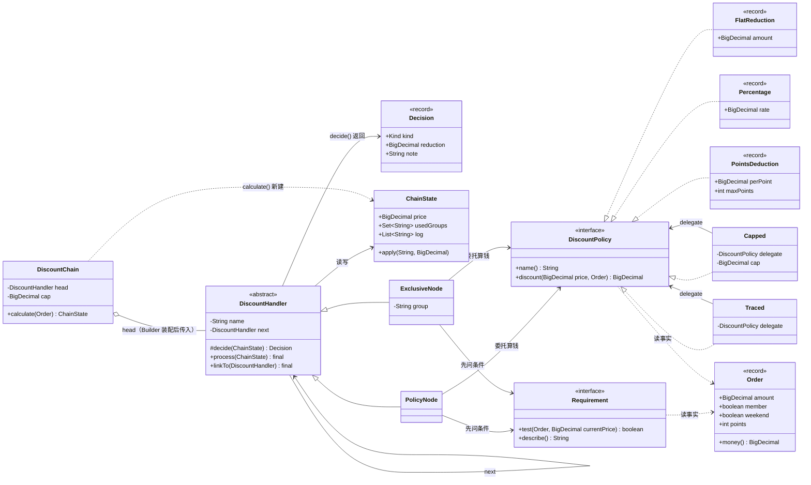
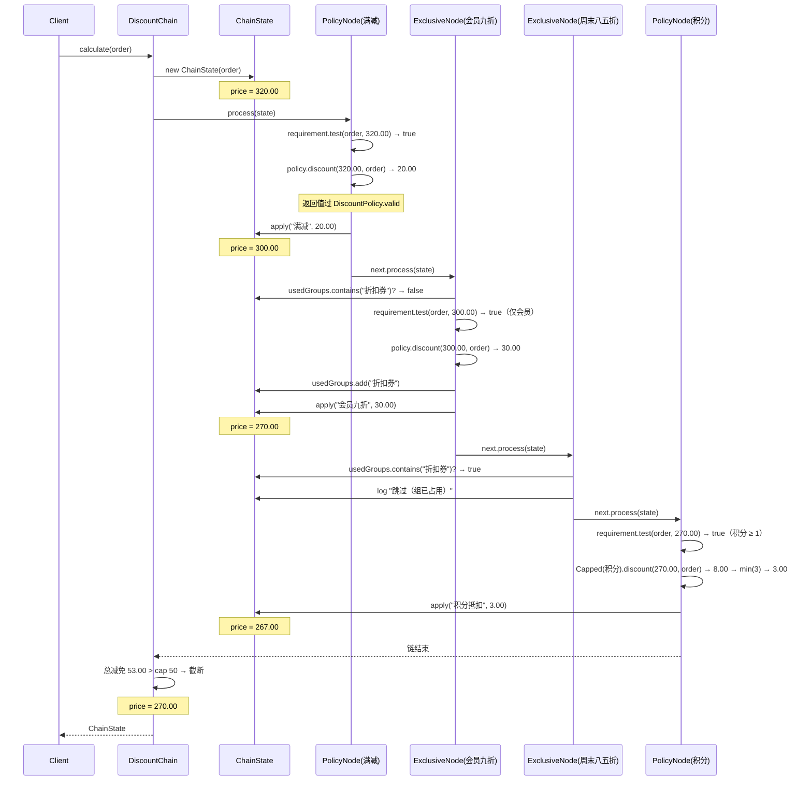

# 练习 01 · 电商订单优惠计算

> **难度** ★★★☆☆ ｜ **建议时长** 60 分钟 ｜ **参考实现** [`solutions/OrderDiscountSolution.java`](solutions/OrderDiscountSolution.java)
>
> **先修**：[策略模式](../../src/com/patterns/behavioral/strategy/README.md) · [责任链](../../src/com/patterns/behavioral/chainofresponsibility/README.md) · [装饰器](../../src/com/patterns/structural/decorator/README.md)
>
> ⚠️ 本文档在第 6 节之前**不会**告诉你要用什么模式。请先把第 5 节的三道题写在纸上，再往下翻。

---

## 1. 业务背景

你在「优选商城」做后端。运营部门有一套优惠券系统，目前线上跑的是下面这段代码，已经两年了。

规则很简单，一共四种券：

| 券 | 条件 | 效果 |
|---|---|---|
| 满减券 `full100_20` | 满 100 元 | 减 20 元 |
| 会员折扣 `member90` | 仅会员 | 打 9 折 |
| 周末折扣 `weekend85` | 仅周末 | 打 8.5 折 |
| 积分抵扣 `points` | 有积分 | 每 100 积分抵 1 元，单次最多抵 5 元 |

全局还有一条：**单笔订单总减免不超过 50 元**。

## 2. 初始实现

```java
static BigDecimal before(Order order, String[] coupons) {
    BigDecimal price = order.money();
    for (String coupon : coupons) {
        if (coupon.equals("full100_20")) {
            if (price.compareTo(new BigDecimal("100")) >= 0) {
                price = price.subtract(new BigDecimal("20"));
            }
        } else if (coupon.equals("member90")) {
            if (order.member()) {
                price = price.multiply(new BigDecimal("0.9"));
            }
        } else if (coupon.equals("weekend85")) {
            if (order.weekend()) {
                price = price.multiply(new BigDecimal("0.85"));
            }
        } else if (coupon.equals("points")) {
            int usable = Math.min(order.points(), 500);
            price = price.subtract(new BigDecimal("0.01").multiply(BigDecimal.valueOf(usable)));
        } else {
            throw new IllegalArgumentException("未知券：" + coupon);
        }
    }
    if (order.money().subtract(price).compareTo(new BigDecimal("50")) > 0) {
        price = order.money().subtract(new BigDecimal("50"));
    }
    return price.setScale(2, RoundingMode.HALF_UP);
}
```

这段代码**能跑，也跑对了两年**。先别急着说它差 —— 想想它为什么能活两年：

- 券种少（4 种）；
- 门槛和算法都没怎么变；
- 一次只叠 1~2 张券。

**能跑的代码不是坏代码。** 判断该不该改，要看接下来发生了什么。

## 3. 需求一波一波来了

### v2（上线 3 个月后）

- 加「品类券」：满 200 减 30，仅限生鲜类目。
- 加「新人券」：首单立减 15，可与满减叠加。

### v3（半年后）

- 会员折扣和周末折扣**不能叠加**（同属"折扣券"组，二选一，取先到的）。
- 满减、积分可以照常叠加。
- 总减免上限从 50 元调到 80 元，并且**不同活动期上限不同**。

### v4（一年后）

- 运营要求：**能查到每一张券为什么没生效**。"用户说我明明有会员，为什么没打折" —— 客服每天收到 200 个这样的工单。
- 财务要求：**积分抵扣单次最多抵 3 元**，但这只是"积分这一种券"的限制，不影响其他券。

### v5（现在）

- 大促期间要支持「券的顺序由运营在后台配置」。
- 财务发现一个**线上 bug**：同一个用户、同一批券，前端传的顺序不同，付的钱差 2 元。客服无法解释。

## 4. 你的任务

> 请在纸上或编辑器里写，**先不要看第 6 节**。

### 任务 A：找出变化点（10 分钟）

把上面 v2~v5 的每一条需求，归类到下面四个盒子里：

| 盒子 | 含义 | 例子 |
|---|---|---|
| **事实** | 业务里不会变的东西 | 订单有金额、有会员标记 |
| **规则** | 会变，但变的是「数值/阈值」 | 满 100 的门槛可能改成 120 |
| **策略** | 会变，而且会出现**新的种类** | 从 4 种券变成 6 种券 |
| **副作用** | 除了算钱还要做的事 | 记录日志、发通知、写账本 |

**问题**：v2~v5 里，哪几条属于「策略」？哪几条属于「规则」？把它们分错会怎样？

### 任务 B：算一笔账（15 分钟）

订单：金额 320.00 元，会员，周末，积分 800。券：满减 → 会员九折 → 积分。

1. 手算 `before()` 的结果（注意封顶）。
2. 如果券的顺序换成「会员九折 → 满减 → 积分」，结果一样吗？为什么？
3. 这个差异说明：代码里有一个**从来没被明确写下来的约定**。它是什么？

> 提示：满减的条件是「满 100」。这个 100 是**订单原价**还是**减完上一张券之后的价**？代码里怎么写的？运营心里的答案又是哪个？

### 任务 C：设计（25 分钟）

在不改变外部行为（同一批券、同一顺序，结果不变）的前提下，让 v2~v5 的每条需求都能「只改一处」。

写下你的类清单：

```
我需要这些接口/抽象类：
  ______________________  负责 ______
  ______________________  负责 ______
  ______________________  负责 ______

v2 加品类券时我要改：
  ______________________

v4 要「能查到每张券为什么没生效」时我要改：
  ______________________

v5 要「积分单券最多抵 3 元」时我要改：
  ______________________
```

**关键约束**：只能用一个模式解决，还是需要几个？如果需要几个，**它们各自负责哪个变化维度**？

## 5. 自检清单

做完任务 A/B/C 后，用这张表给自己打分（每项 1 分）：

<details>
<summary>点开自检清单（先自己答，再对照）</summary>

| # | 问题 | 及格答案 |
|---|---|---|
| 1 | 「加一种券」属于哪个盒子？ | **策略**。不是"规则"——规则变的是数字，加券变的是种类数。 |
| 2 | 「门槛从 100 改成 120」属于哪个盒子？ | **规则**。如果为了这个去加类，就是过度设计。 |
| 3 | 满减的 100 比较的是原价还是当前价？ | **当前价**（循环里的 `price` 已经减过前面的券）。但代码里没有任何一行写下这个约定，运营默认是原价 —— 这个没人定义的约定，才是 v5 的 bug 根源。 |
| 4 | 「查到每张券为什么没生效」需要什么？ | 需要一个**能表达"跳过原因"的返回值**。boolean 不够，必须是要么"命中 + 金额"、要么"跳过 + 原因"的二元结果。 |
| 5 | 「同组二选一」是券的属性还是链的属性？ | **链的属性**。券不该知道自己和谁互斥（否则加一张券要改所有券）。 |
| 6 | 「积分单券最多抵 3 元」和「总减免上限 50 元」是同一件事吗？ | **不是**。前者是"某个算法的上限"，后者是"整条链的上限"。混为一谈就会写出「每张券都封顶了，叠起来还是减了 200」。 |
| 7 | 需要几个模式？ | 至少 **3 个变化维度**：条件（门槛会变）、算法（会新增种类）、顺序与互斥（运营可配）。三维度各用一个机制，而不是硬塞进一个。 |

**评分**：
- 5~7 分：可以直接看参考答案，重点看任务 B 的 bug 分析。
- 3~4 分：先回看 [策略](../../src/com/patterns/behavioral/strategy/BEGINNER.md) 和 [责任链](../../src/com/patterns/behavioral/chainofresponsibility/BEGINNER.md) 的「适用边界」章节。
- 0~2 分：不要往下看。先做一遍 [优惠券入门 Demo](../../src/com/patterns/behavioral/strategy/beginner/BeginnerDemo.java)。

</details>

---

<div align="center">

# ⬇️ 以下为参考答案

**做完第 4 节再看**

</div>

---

<details>
<summary><b>展开参考答案（§6 ~ §13）</b> —— 建议先完成第 4 节的三道题，并打完第 5 节自检表</summary>

## 6. 变化点分析

| 需求 | 盒子 | 正确机制 | 错误机制（常见误判） |
|---|---|---|---|
| v2 加品类券 / 新人券 | 策略 | 新增一个"优惠算法"实现 | 在 if-else 里加分支 |
| v3 同组互斥 | 链的顺序 + 分组标记 | 链节点携带 group，命中后占用 | 让每张券知道"我和谁互斥" |
| v3 上限可配 | 规则 | 构造时传参 | 每种券各自封顶 |
| v4 查跳过原因 | 返回值语义 | 二元结果（命中/跳过 + 原因） | 加一个 `lastSkipReason` 字段 |
| v4 积分单券封顶 | 策略装饰 | 装饰器包住"积分"这一个算法 | 在链上塞一个"封顶节点" |
| v5 顺序可配 | 装配 | Builder 按配置表装配 | 让券自己排序 |
| v5 顺序敏感 bug | **事实层面的缺失** | 明确「门槛用当前价」，并写进签名 `test(Order, currentPrice)` | 靠"大家都知道"来维持 |

**最关键的一行**：v5 的 bug 不属于任何一种"加需求"，它属于**原来的代码从来没有定义过"门槛按哪个价算"**。这类问题不能靠加模式解决，只能靠把隐含约定变成显式规则 + 测试。

## 7. 方案推导

### 第 1 步：把「条件」和「算法」分开

`if (price >= 100) price -= 20;` 这一行里塞了两件事：

- **条件**（满 100）—— 运营每周调；
- **算法**（减 20）—— 几个月不动。

两者的变化频率差一个数量级，所以拆开：

```java
interface Requirement {
    // 条件既要看订单事实（会员/周末/积分），也要看「减到现在的价」。
    // 「满 100」跟哪个价比，写在签名里，不写在注释里。
    boolean test(Order order, BigDecimal currentPrice);
    String describe();
}

interface DiscountPolicy {
    String name();
    // 算法只回答「减多少」：不判门槛，也不重复校验自己的返回值。
    BigDecimal discount(BigDecimal price, Order order);
}
```

为什么 `discount` 要收 `price` 而不是只收 `Order`？
因为**必须显式声明门槛和折扣基于哪个价**。传 `price` 就把这个约定变成了签名的一部分 —— 这是 v5 bug 的根治办法。

### 第 2 步：把「跳过原因」变成返回值的一部分

v4 要求能查原因，`boolean` / `BigDecimal.ZERO` 都表达不了"为什么是 0"。

```java
record Decision(Kind kind, BigDecimal reduction, String note) { }
```

这一步是**整个改造里最有价值的一步**，因为它把"没生效"从一个隐含状态变成了一个有内容的对象。

### 第 3 步：把「顺序 + 互斥」交给链

券本身的职责是「算钱」，不是「排在第几」。排序是**装配问题**，所以放在 `Builder` 里；互斥是**链的共享状态**，所以放在 `ChainState` 里。

```java
final Set<String> usedGroups = new LinkedHashSet<>();
```

`ExclusiveNode` 判断 `usedGroups.contains(group)`，命中就标记占用。**券本身完全不知道有"组"这回事** —— 这是最关键的职责边界。

### 第 4 步：把「两种封顶」分开

| | 作用对象 | 放在哪 | 能有几个 |
|---|---|---|---|
| 单券上限（积分最多抵 3 元） | 一个算法 | 策略装饰器 `Capped` | 每个策略各配一个 |
| 整单上限（总减免不超 50） | 整条链的结果 | `DiscountChain.cap` 字段 | 全局一个 |

合并成一个就会出现「每张券都封顶了，叠起来还是减了 200」的 bug —— 这是真实系统里最常见的优惠券缺陷之一。

## 8. 类图



**读图要点**：

- `DiscountHandler` 持有 `next`（自关联）—— 链的形状；
- `PolicyNode` / `ExclusiveNode` **同时**依赖 `DiscountPolicy` 和 `Requirement` —— 这是"策略"和"链"的接缝；
- `Requirement` 收 `currentPrice`：条件既能读订单事实（`member()`），也能读「减到现在的价」，**门槛按哪个价算由装配时选的实现决定，不由注释约定**；
- `Capped` / `Traced` 既是 `DiscountPolicy`（`..|>`）又持有被装饰者（`-->`），这是装饰器在类图上的典型双线；3 个 `record` 是叶子算法；
- `DiscountPolicy` **不依赖** `Decision` —— 它只返回一个金额，包不包装成「命中 / 跳过」是链节点的事（本题上一版图里画过这条线，是错的，已删）；
- `DiscountChain` 用聚合（`o--`）持有 head：节点由 `Builder` 创建并 `linkTo` 串好，再作为参数传进 `DiscountChain` —— 链对象只负责「从哪进、整体封顶」，不负责节点的生与死，所以不是组合（`*--`）；
- `Requirement` 和 `DiscountPolicy` 都没有指向 `Order` 以外的依赖 —— 它们可以被单测。

## 9. 执行流程



**注意三组数字**：

- 会员九折按 **300.00** 算，不是按 320.00 算 → 减 30.00 而不是 32.00；
- 总减免 53.00 超过上限 50 → 最终付 **270.00**，和改造前的 `before()` 一致；
- 每个节点的门槛都拿**当前价**去比（320 → 300 → 270）。本例三种价都 ≥ 100，所以看不出差别；真正会分叉的是「原价 120、先减 30」那种订单 —— 参考实现里 `atLeast`（当前价）与 `atLeastOriginal`（原价）并排给出，运行后能直接看到 90.00 vs 70.00。

行为一致，但每条路径都可查、可配、可单测。

## 10. 参考实现

完整可运行代码：[`solutions/OrderDiscountSolution.java`](solutions/OrderDiscountSolution.java)（约 660 行，含改造前对照实现与边界验证）

```bash
java docs/practice/solutions/OrderDiscountSolution.java
```

关键片段（`Requirement` + `DiscountPolicy` 的签名，这是修复 v5 bug 的核心）：

```java
interface Requirement {
    /** currentPrice 是当前价；「满 100」到底比哪个价，由实现决定，但必须写在签名里。 */
    boolean test(Order order, BigDecimal currentPrice);
    String describe();
}

interface DiscountPolicy {
    String name();

    /** price 是当前价（前面节点减过的价），不是订单原价。算法不判门槛，只回答「减多少」。 */
    BigDecimal discount(BigDecimal price, Order order);

    /** 所有实现的返回值都从这里过一道：null / 负数 / 未对齐到分。 */
    static BigDecimal valid(BigDecimal value, String who) { ... }
}
```

**两个容易写错的地方**（参考实现里都有反向注释）：

1. **「满 100」只能在一个地方判。** 以前 `FullReduction` 自己存一份 `threshold`、`Requirement.atLeast` 又存一份，两边用的价还不一样，于是会出现「日志说命中、实际减 0」。现在 `FlatReduction` 只返回一个金额，一个满减券 = `条件(满100) + 算法(减20)`，是两个对象；
2. **配置错误必须在装配期炸。** `Percentage` 限定 `(0, 1)`、`FlatReduction` / `Capped` / 整链 `cap` / `Requirement` 门槛拒绝负数 —— 全部在构造器里抛 `IllegalArgumentException`，不会流到算钱时变成一个怪数。主程序最后有 6 条 `reject(...)` 现场演示。

关键片段（链装配 —— 这里有一个曾经踩过的坑）：

```java
DiscountHandler head = nodes.get(0);
DiscountHandler cursor = head;
for (int i = 1; i < nodes.size(); i++) {
    cursor.linkTo(nodes.get(i));
    cursor = nodes.get(i);          // ← 必须这样写
}
```

> **这个坑值得单独说**：`linkTo` 返回 `this` 是为了支持 `a.linkTo(b).linkTo(c)` 的流式写法。
> 但如果装配时写成 `cursor = cursor.linkTo(nodes.get(i))`，`cursor` 永远等于第一个节点，
> 每次都覆盖 `head.next` —— 最后只有首尾两个节点存活，中间的全被跳过。
> 参考实现的第一版就踩了这个坑，日志里"会员九折"直接消失。**任何链式装配都要打日志验证节点数量。**

## 11. 为什么不选其他模式

| 候选 | 为什么不用 |
|---|---|
| **只有策略，不用链** | 策略能解决"加一种券"，但解决不了"同组互斥"和"顺序可配"。谁来保证"先满减后折扣"？只能靠调用方手动排 —— 那就是把顺序依赖推给了每个调用点。 |
| **只有链，不用策略** | 可以：每个节点自己写 `if` 算钱。但那样"加一种券"等于"加一个节点类"，而且算法无法被单独测试、单独复用（同一个 9 折可能出现在三处）。 |
| **模板方法** | 模板方法要求"步骤固定、步骤内实现可变"。优惠券是"步骤数量本身可变"（3 张券 vs 5 张券），骨架锁不住。 |
| **状态机** | 订单状态有明确的有限状态集，优惠券没有 —— 券之间没有"当前状态"的概念，只有"生效/不生效"。 |
| **规则引擎 / DSL** | 这是 v3 之后一个真实的诱惑。规则引擎能表达"满 100 且是会员且非周末"，但当规则数量 < 50、变动频率 < 每周一次时，引入规则引擎的代价（学习、调试、性能、排查困难）远大于收益。见 [选择指南 §2](../pattern-selection-guide.md)。 |

## 12. 过度设计的五种样子

这个练习最容易走偏的五个方向，任何一个出现都说明"改过头了"：

1. **为门槛加类**。`Threshold100`, `Threshold120`, `Threshold200` 各一个类 —— 门槛是数据，不是行为，应该 `new BigDecimal("120")`。
2. **用一个接口包住所有东西**。`interface DiscountStep { void execute(Context ctx); }`，然后条件和算法都实现它 —— 结果每个 `DiscountStep` 都要自己判断"我是不是算法"，链上全是 `instanceof`。
3. **把 Order 做成可变对象**。为了"少传参数"，让节点直接改 `order.setPrice(...)`。这样重试一次就会二次打折，而且无法并行、无法缓存。
4. **给每种券配一个工厂 + 一个配置类 + 一个注册表**。券的种类是 6 种，配置类是 6 个 —— 配置本身的维护成本超过了它省下的 if-else。
5. **引入规则引擎**。理由通常是"以后规则会很复杂"。先问：现在的规则数量是多少？谁在改？改一次要多久？如果答案是"5 条，开发改，2 小时"，那就该继续用代码。

## 13. 延伸

- **想再看一遍同类设计**：[`combined/orderservice`](../../src/com/patterns/combined/orderservice/README.md) 是同一套思路的工程版，多了账本、追踪、配置解析。
- **想理解"策略和链为什么能拼在一起"**：[选择指南 §6](../pattern-selection-guide.md) 有五种"策略 vs 责任链"的对比场景。
- **想理解"什么时候连策略都不该用"**：[选择指南 §7](../pattern-selection-guide.md) 的"订单优惠五版演进"讲了同一需求在五个阶段的**不同最优解** —— 第一版最优解是 if-else。

</details>

---

**上一节**：[实践总览](README.md) ｜ **下一节**：[练习 02 · 订单状态流转](02-order-state.md)
