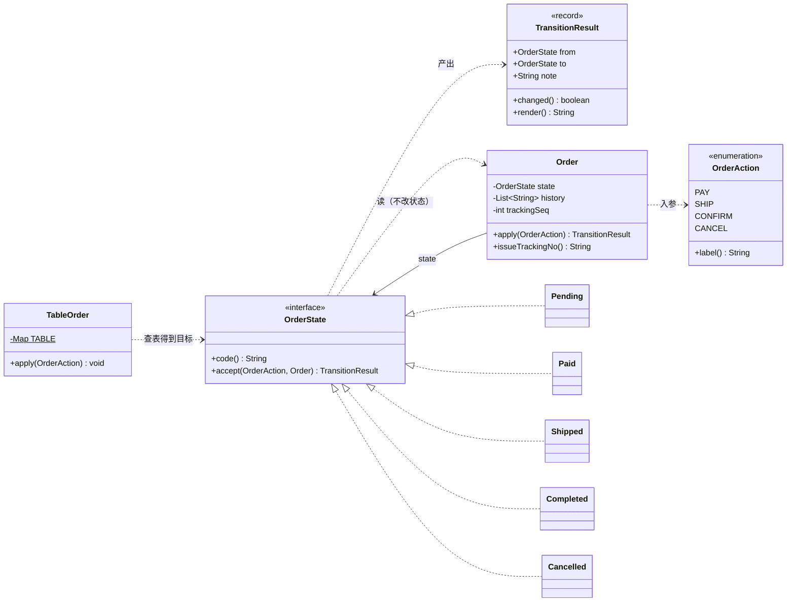
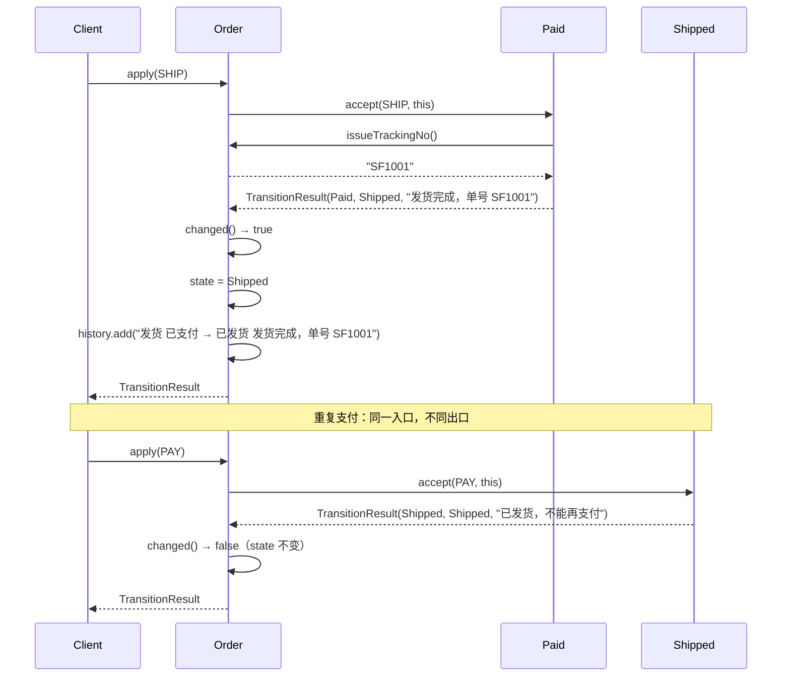

# 练习 02 · 订单状态流转

> **难度** ★★★☆☆ ｜ **建议时长** 45 分钟 ｜ **参考实现** [`solutions/OrderStateSolution.java`](solutions/OrderStateSolution.java)
>
> **先修**：[状态模式](../../src/com/patterns/behavioral/state/README.md) · [策略模式](../../src/com/patterns/behavioral/strategy/BEGINNER.md)
>
> ⚠️ 这个练习的答案可能让你意外：**很多时候查表比状态模式更好**。做完第 4 节再看第 6 节。

---

## 1. 业务背景

你在做电商后台的订单中心。订单有五个状态：待支付、已支付、已发货、已完成、已取消。四个动作：支付、发货、确认收货、取消。

## 2. 初始实现

```java
void apply(OrderAction action) {
    switch (state) {
        case PENDING -> {
            if (action == PAY) state = PAID;
            else if (action == CANCEL) state = CANCELLED;
        }
        case PAID -> {
            if (action == SHIP) state = SHIPPED;
            else if (action == CANCEL) state = CANCELLED;
        }
        case SHIPPED -> {
            if (action == CONFIRM) state = COMPLETED;
        }
        default -> { }
    }
}
```

24 行，跑得很好。`default -> { }` 那句尤其"好"—— 它把所有非法操作默默吞掉了。

## 3. 需求一波一波来了

### v2

- 已发货状态下点"取消"，不能默默吞掉，要返回明确错误："已发货，请走退货流程"。
- 客服后台要能看到**理由**，所以所有动作都要返回结构化结果，不能是 void。

### v3

- 重复支付必须**幂等忽略**（前端重复点、支付回调重试都会触发）。
- 已支付取消要**触发退款**；待支付取消**不需要**退款。同一句"取消"，两条路径。

### v4

- 发货要生成物流单号，写进订单。
- 新增「部分退款」动作：**不换状态**，但要改金额、记流水。

### v5

- 运营希望**在后台配置**状态机（新增大促期间特有的"预售中"状态）。

## 4. 你的任务

### 任务 A：数一数（10 分钟）

1. 状态数 × 动作数 = 24 种组合。这 24 种里，有几对是"结果相同、含义不同"的？
2. `default -> { }` 吞掉了哪些信息？给三个具体的客服场景，说明它会造成什么后果。
3. v4 的「部分退款，不换状态」如果硬塞进 `switch`，代码会变成什么样？**能不能塞进一张"当前状态 → 新状态"的表**？

### 任务 B：两种方案对比（15 分钟）

分别写出下面两套方案的骨架：

**方案甲：状态对象**

```
我需要一个接口 ______________________，它有一个方法 ______________________
每个状态是 ______________________（类 / 枚举 / 记录）
```

**方案乙：状态转移表**

```
表的结构：Map<___, Map<___, ___>>
v4 的「部分退款」怎么放进这张表？______________________
v3 的「退款副作用」怎么放进这张表？______________________
```

### 任务 C：决策（15 分钟）

针对下面三个变体，各选一个方案并说明理由：

| 变体 | 你的选择 | 理由 |
|---|---|---|
| 变体 1：只有 3 个状态、4 个动作、规则十年不变 | | |
| 变体 2：20 个状态，运营在后台配，每周改 | | |
| 变体 3：5 个状态，但每个状态的动作都有副作用（发货生成单号、取消退款、确认收货发积分） | | |

## 5. 自检清单

<details>
<summary>点开自检清单</summary>

| # | 问题 | 及格答案 |
|---|---|---|
| 1 | 「重复支付」和「未支付不能发货」在表里长得一样吗？ | **一样** —— 都是"表里没有这条规则"。但业务上完全不同：一个是幂等忽略（成功），一个是拒绝（失败）。这是查表方案最大的短板。 |
| 2 | `default -> { }` 的问题是什么？ | 把"非法"和"合法但无事发生"混为一谈。客服看不到理由，也无法区分"系统 bug"和"用户操作错误"。 |
| 3 | 状态对象应该自己改 Order 吗？ | **不应该**。状态只回答"收到这个动作该怎么反应"，改状态由 Order 统一做。否则状态之间有隐式的写权限混乱。 |
| 4 | 「部分退款」能放进转移表吗？ | **不能**。表只能表达"从 A 到 B"，表达不了"留在 A 但要改金额"。 |
| 5 | 变体 2（20 个状态、运营配）该选哪个？ | **查表**。状态多 + 变化频繁 + 无副作用 → 表的"一眼可见"和"改一行"胜过状态模式的"每个状态一个类"。 |
| 6 | 变体 3（每状态都有副作用）该选哪个？ | **状态对象**。副作用需要位置安放，表只能放一个目标状态。 |

**评分**：5~6 分可以往下看；3~4 分重读 [状态模式适用边界](../../src/com/patterns/behavioral/state/README.md)；0~2 分先看 [状态入门 Demo](../../src/com/patterns/behavioral/state/beginner/BeginnerDemo.java)。

</details>

---

<div align="center">

# ⬇️ 以下为参考答案

</div>

---

<details>
<summary><b>展开参考答案（§6 ~ §13）</b> —— 建议先完成第 4 节的三道题，并打完第 5 节自检表</summary>

## 6. 变化点分析

| 需求 | 变化的是什么 | 该动的机制 |
|---|---|---|
| v2 返回理由 | **返回值语义**（void → 结构化结果） | 引入 `TransitionResult` |
| v3 幂等忽略 | 同一动作在不同状态下**语义不同** | 状态对象（表表达不了） |
| v3 取消退款 | **副作用**（一个状态转换带一个动作） | 状态对象的方法体 |
| v4 物流单号 | **副作用** + **需要读 Order** | 状态对象（参数里给 Order） |
| v4 部分退款 | **不换状态的动作** | 状态对象（表表达不了） |
| v5 后台配置 | **状态集合本身可变** | 查表（对象方案要动态生成类，做不到） |

**所以这个练习的正确答案不是"用状态模式"，而是**：

> 前四条需求指向状态对象，最后一条需求指向查表。**两者不可兼得**，必须做取舍。
> 取舍的依据是：v5 是真的吗？如果运营真的会频繁配置状态机，那么状态对象方案在这个项目里是错的。

## 7. 为什么返回值必须结构化

```java
record TransitionResult(OrderState from, OrderState to, String note) {
    boolean changed() { return from != to; }
}
```

三个字段各解决一件事：

| 字段 | 解决的问题 | 只有 boolean 时的后果 |
|---|---|---|
| `from` / `to` | 「到底变没变」 | 靠返回值猜，猜错就双重扣款 |
| `note` | 「为什么没变」 | 客服只能看到"操作失败"，每天 200 个工单 |
| 整体不可变 | 调用方不能篡改结果 | 结果被下游改掉，日志和实际不符 |

关键判断：`changed()` 用**引用比较**（`from != to`）而不是 `equals`。因为状态是枚举单例，引用相等就是"同一个状态"。如果以后改成可变对象，这里必须改回 `equals` —— 这是个值得写进注释的约定。

## 8. 状态对象怎么写才不越权

```java
interface OrderState {
    String code();
    TransitionResult accept(OrderAction action, Order order);
}
```

**为什么参数里有 `Order`**：发货要生成单号，状态需要读订单的计数器。但注意两个限制：

1. 状态**只能读**（调 `order.issueTrackingNo()`），不能写 `order.setState(...)`；
2. 改状态由 `Order.apply` 统一做 —— 它是唯一的状态写入口。

```java
TransitionResult apply(OrderAction action) {
    TransitionResult result = state.accept(action, this);
    if (result.changed()) {
        state = result.to();           // 唯一的写点
    }
    history.add(action.label() + "  " + result.render());
    return result;
}
```

这个约束的价值：**状态转换只有一个地方发生**，想加审计、加事件、加重试，都只需要改这一个方法。如果让状态自己改自己，这个统一入口就没了。

## 9. 查表版为什么"丢东西"

```java
private static final Map<OrderState, Map<OrderAction, OrderState>> TABLE = new LinkedHashMap<>();
```

查表能表达的：`(当前状态, 动作) → 新状态`。
查表**不能**表达的：

| 表达不了的东西 | 具体例子 | 后果 |
|---|---|---|
| 语义差别 | 重复支付（幂等）vs 未支付发货（拒绝） | 都变成"不支持" |
| 副作用 | 发货生成单号 | 只能塞回 Order 里 if |
| 不换状态的动作 | 部分退款 | 表里无法表示 |
| 拒绝理由 | "已发货，请走退货流程" | 只能给统一错误码 |

**但它能表达的也很重要**：状态多、变化频繁时，一张表比 20 个类好维护得多。真实项目里 `state/TransitionTable.java` 就是这套对照 —— 它被**刻意保留**为反例，不是失败实现。

## 10. 类图



**读图要点**：

- `Order --> OrderState`：订单**持有**状态（组合关系，一方持有引用）；
- `OrderState ..> Order`：状态**反向依赖**订单（虚线 = 依赖，不是持有）—— 这是双向的，有人会担心循环依赖，但这里 `Order` 依赖的是接口，`OrderState` 依赖的是具体类，实际的循环被接口打断了；
- **状态唯一写入口是 `Order.apply`**，图上表现为只有 `Order` 有 `state` 字段。

## 11. 执行流程



## 12. 参考实现

完整可运行代码：[`solutions/OrderStateSolution.java`](solutions/OrderStateSolution.java)（约 300 行，两套实现对照）

```bash
java docs/practice/solutions/OrderStateSolution.java
```

运行输出里四段值得注意：

1. **正常单**：支付 → 重复支付（幂等）→ 发货 → 确认收货 → 取消（被拒）；每一步都有 `from → to` 和理由；
2. **异常路径**：同一套状态，换一条路径，行为一致；
3. **查表版**：同样的动作序列，但"重复支付"变成"不支持的动作"—— **语义丢了**；
4. **加动作/加状态各要改哪里**：状态模式 5 处表态（成本），查表版加一行但编译器不提醒（风险）。

## 13. 为什么不选其他模式

| 候选 | 为什么不用 |
|---|---|
| **策略模式** | 状态和策略的共同点是"都委托给一个接口"。区别：策略由**调用方**替换（我今天用支付宝，明天用微信），状态由**对象自身**转换（订单自己从待支付变成已支付）。这里状态转换是业务规则，不是调用方选择。 |
| **责任链** | 链是"一个请求沿链找处理者"，状态是"同一对象在不同状态下对同一请求给出不同反应"。链处理不了"当前状态"这个概念。 |
| **switch + 枚举** | 就是初始实现。v2 之后每个分支都要返回结构化结果，`switch` 会变成 200 行的巨型方法。**但它不是错的** —— 如果需求停在 v1，switch 就是最优解。 |
| **只查表** | 见 §9。数据驱动路线在"状态多、无副作用、频繁配置"时反而更优。 |

## 14. 过度设计的四种样子

1. **给每个状态配一个工厂 + 一个转换器 + 一个监听器**。5 个状态生出 15 个类，最后发现监听器只有一个空实现。
2. **把 `TransitionResult` 换成事件总线**。"状态变化要发事件"是对的，但如果只有订单一个订阅者，`apply` 里直接调一下更清楚。
3. **引入 Spring StateMachine**。这是这个练习最真实的诱惑。问三个问题：状态数 > 15 吗？需要持久化中间状态吗？需要分布式协调吗？三个都否 → 自己写 300 行比学框架快。
4. **让状态对象自己持有 Order 引用**。状态是单例（枚举），持有 Order 会导致一个状态对象指向一个订单，单例语义直接破掉。

## 15. 延伸

- **想看工程版的完整实现**：[`behavioral/state`](../../src/com/patterns/behavioral/state/README.md)，里面有 `TransitionTable` 这个**刻意保留的反例**。
- **想理解"什么时候状态模式该退化成枚举 + switch"**：[选择指南 §6](../pattern-selection-guide.md) 的"策略 vs 状态"小节。
- **想看"状态 + 命令"怎么配合**（订单撤销）：[`behavioral/command`](../../src/com/patterns/behavioral/command/README.md)。

</details>

---

**上一节**：[练习 01 · 电商订单优惠计算](01-order-discount.md) ｜ **下一节**：[练习 03 · 消息通知系统](03-notification.md)
