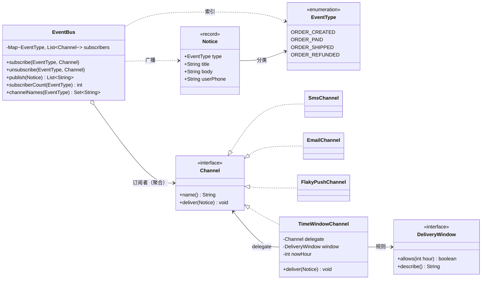
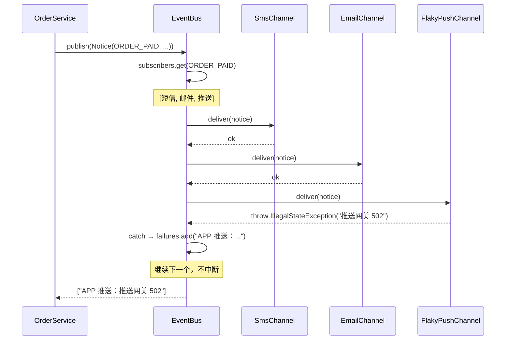

# 练习 03 · 消息通知系统

> **难度** ★★☆☆☆ ｜ **建议时长** 40 分钟 ｜ **参考实现** [`solutions/NotificationSolution.java`](solutions/NotificationSolution.java)
>
> **先修**：[观察者模式](../../src/com/patterns/behavioral/observer/README.md)
>
> ⚠️ 这个练习要破除一个常见误解：**「一对多」不等于「观察者」，也不等于「中介者」**。请先把第 4 节写完。

---

## 1. 业务背景

订单系统需要在关键节点通知用户：

- 订单创建 → 提醒尽快支付；
- 支付成功 → 告知已付款；
- 订单发货 → 告知物流；
- 退款完成 → 告知到账。

渠道有四个：短信、邮件、站内信、APP 推送。

## 2. 初始实现

```java
void send(Notice notice) {
    if (notice.type() == ORDER_PAID || notice.type() == ORDER_SHIPPED) {
        System.out.println("[短信] " + notice.userPhone() + " ← " + notice.body());
    }
    if (notice.type() != ORDER_PAID) {
        System.out.println("[邮件] " + notice.title());
    }
    System.out.println("[站内信] " + notice.title());
    if (notice.type() != ORDER_CREATED) {
        System.out.println("[推送] " + notice.title());
    }
}
```

20 行，四个渠道，跑得很好。**注意：这四个 `if` 才是这段代码的真实结构** —— 订阅关系。

## 3. 需求一波一波来了

### v2

- 加「钉钉」渠道，只发支付成功。
- 加「企业微信」，只发发货通知。
- 邮件从"所有非支付事件"改成"订单创建 + 发货"。

### v3

- 营销类推送**夜间 21:00 - 次日 9:00 不发**（合规要求），但**验证码短信随时发**。
- 意思是：同一个渠道，不同业务的时间规则不同。

### v4

- 用户中心要支持「退订某个渠道的某类通知」—— 退订营销推送，但仍收支付通知。
- 渠道会**动态增删**（灰度期间只对 10% 用户开钉钉）。

### v5

- 发送失败要能重试，且**一个渠道失败不能影响其他渠道**。

## 4. 你的任务

### 任务 A：数排列组合（10 分钟）

1. 4 个渠道 × 4 个事件 = 16 种"发不发"的组合。现在代码里有几个 `if` 在表达这 16 种组合？
2. v2 之后变成 6 渠道 × 4 事件 = 24 种。**如果继续用 `if`，代码会变成什么样？**
3. `if (type != ORDER_CREATED)` 这种"取反"写法有什么危险？（提示：加第五个事件时）

### 任务 B：三个方案的取舍（20 分钟）

在纸上画出下面三个方案的结构，各写三行优缺点：

**方案甲：集中式中转站**

```
一个中心类，里面一张 Map<事件, 渠道列表>，然后 switch(渠道) 分发
```

**方案乙：事件总线 + 订阅者**

```
一个总线对象，subscribe(事件, 渠道) / publish(事件)
每个渠道实现统一接口
```

**方案丙：责任链**

```
一个事件沿链传递，每个渠道判断"我要不要发"，返回 true 继续 / false 停止
```

**关键问题**：
- 方案甲里，"加一个钉钉渠道"要改哪几个地方？
- 方案丙里，短信渠道返回 `false`（表示"我不发"）会发生什么？
- 方案乙里，谁负责保证"订阅关系正确"？

### 任务 C：边界设计（10 分钟）

1. v3 的"同一渠道不同业务时间规则不同"该放在哪一层？放在渠道内部还是外面？
2. v5 的"一个渠道失败不影响其他"用 try-catch 包在哪一层？包在总线里还是包在渠道里？
3. 为什么 `Channel` 接口**不应该**有 `subscribedEvents()` 方法？

## 5. 自检清单

<details>
<summary>点开自检清单</summary>

| # | 问题 | 及格答案 |
|---|---|---|
| 1 | 初始实现里订阅关系藏在哪？ | 藏在 4 个 `if` 的条件里。改订阅 = 改条件 = 改代码 = 发版。 |
| 2 | `type != ORDER_CREATED` 的危险？ | 加了 `ORDER_REFUNDED` 后，它自动被推送 —— 运营没要，但它开始发了。**取反是隐式加入**。 |
| 3 | 方案甲"加钉钉"要改几处？ | 3 处：ROUTES 表、switch 分支、渠道实现。所以它是上帝类。 |
| 4 | 方案丙里短信返回 false 会怎样？ | 邮件、站内信、推送全都不执行 —— 一个渠道替别人做了决定。**责任链的语义不适合广播。** |
| 5 | 方案乙谁保证订阅关系正确？ | **装配代码**（启动时的配置）。这不是缺陷，而是把"业务配置"从"代码逻辑"里分离出去。 |
| 6 | 时间规则放哪层？ | **渠道外面**（装饰器）。因为同一渠道不同业务规则不同，放内部就要在渠道里分流。 |
| 7 | try-catch 包哪层？ | **总线层**。包在渠道里意味着每个渠道都要写一遍，且新渠道容易忘。 |
| 8 | 为什么不要 `subscribedEvents()`？ | 让渠道声明订阅，等于让渠道知道"事件总线"这个概念，反向多了一层耦合。订阅是装配关系，不是渠道的能力。 |

**评分**：6~8 分可以直接看答案；4~5 分重读 [观察者](../../src/com/patterns/behavioral/observer/BEGINNER.md)；0~3 分先做 [观察者入门 Demo](../../src/com/patterns/behavioral/observer/beginner/BeginnerDemo.java)。

</details>

---

<div align="center">

# ⬇️ 以下为参考答案

</div>

---

## 6. 核心判断：广播 ≠ 链

| | 责任链 | 观察者 / 事件总线 |
|---|---|---|
| 接收者数量 | **一个**（找到能处理的就停） | **多个**（所有订阅者都收到） |
| 谁决定停止 | 链上的处理者 | 没有"停止"这个概念 |
| 典型接口返回值 | `boolean` / `Outcome`（能不能处理） | `void`（收到就行） |
| 适合 | 校验、审批、中间件 | 通知、事件、日志 |

**为什么方案丙（链）是错的**：因为链的接口天然要回答"我处理了吗"。一旦短信渠道说"处理了"，后面的就都被跳过了。而通知的本质是"所有关心的人都要知道"。

这个判断有一个简单的检验方法：**把接口返回值去掉，还成立吗？** 观察者的 `deliver` 可以返回 `void`，链的 `handle` 不能。

## 7. 为什么"中转站"也不是好答案

`NotificationCenter`（`Map<事件, List<渠道名>>` + `switch`）比 `if-else` 好，因为订阅关系变成了数据。但它仍然是上帝类：

```
加渠道 → 改 switch
改订阅 → 改 ROUTES
加"某渠道只看某类事件" → 改 ROUTES 结构
加"渠道 A 必须在渠道 B 前" → 改 ROUTES 为 List<Rule>
```

**它知道所有渠道**，这是它和事件总线的根本差别。总线只认识 `Channel` 接口，一个具体渠道也不认识。

这也解释了为什么它不是**中介者模式**：中介者是为了消除多对多的连线（A↔B, A↔C, B↔C 变成 A→M, B→M, C→M）。通知的拓扑本来就是星型（事件 → 多个接收者），**没有需要消除的连线**。把星型改成"星型 + 一个中心表"，只增加了一层。

## 8. 三个设计的职责边界

```
EventBus        只做三件事：登记、注销、广播。不认识任何具体渠道。
Channel         只做一件事：把一个 Notice 送出去。
DeliveryWindow  只做一件事：判断现在能不能发。
TimeWindowChannel  装饰器：把窗口规则套在任意渠道上。
```

四条边界各对应一个变化维度：

| 维度 | 变化频率 | 承担者 |
|---|---|---|
| 有哪些渠道 | 季度 | `Channel` 实现 |
| 谁订阅什么 | 每周 | 装配代码（`subscribe` 调用） |
| 发送时间规则 | 法规变才变 | `DeliveryWindow` |
| 失败处理 | 稳定 | `EventBus.publish` |

**边界设计的判据**：如果一个变化只影响一个维度，说明边界对了。

## 9. UML



**读图要点**：

- `EventBus o--> Channel` 用**聚合**（空心菱形）而不是组合：总线不负责渠道的生与死，渠道可以在订阅前就存在、退订后继续存在；
- `TimeWindowChannel --> Channel`：装饰器持有被装饰者，且**自己也实现了同一个接口** —— 这是装饰器的定义特征，不是普通代理；
- `EventBus` 的字段类型是 `Map<EventType, List<Channel>>` —— 它不知道任何具体渠道名，这是它和 `NotificationCenter` 的分界线。

## 10. 执行流程



**try-catch 在总线层**，不在渠道层。这样：

- 渠道实现只管"怎么发"，不用关心失败处理；
- 新渠道自动获得"失败隔离"，不会忘；
- 失败列表返回给调用方，由业务决定是否重试 / 告警。

## 11. 参考实现

完整可运行代码：[`solutions/NotificationSolution.java`](solutions/NotificationSolution.java)（约 400 行，含三套对照实现）

```bash
java docs/practice/solutions/NotificationSolution.java
```

输出里五段对应上文的分析：

1. 改造前 — 4 个 `if` 表达订阅关系；
2. 反例中转站 — 订阅变数据，但仍是上帝类；
3. 事件总线 — 3 个订阅者，推送失败，短信照发；
4. 时间窗装饰器 — 23 点拦截推送，短信完全不知道有宵禁；
5. 运行时退订 — 同一个渠道对不同事件的去留可以不同。

关键片段（广播的失败隔离）：

```java
List<String> publish(Notice notice) {
    List<String> failures = new ArrayList<>();
    for (Channel channel : subscribers.getOrDefault(notice.type(), List.of())) {
        try {
            channel.deliver(notice);
        } catch (RuntimeException e) {
            failures.add(channel.name() + "：" + e.getMessage());
        }
    }
    return failures;
}
```

## 12. 为什么不选其他模式

| 候选 | 为什么不用 |
|---|---|
| **责任链** | 见 §6。链的返回值和短路语义与广播冲突。 |
| **中介者** | 拓扑是星型，没有需要消除的多对多连线。硬用会变成 `NotificationCenter` 那样的上帝类。 |
| **策略** | 策略是"一个算法有多个实现，调用方选一个"。这里是"一个事件有多个接收者，全部都要跑"。维度不同。 |
| **命令** | 命令把"一次操作"封装成对象，适合排队、撤销、审计。通知不需要撤销，也不排队（同步发送时）。**如果通知需要异步队列 + 重试 + 死信**，那时命令模式才真正合适。 |
| **模板方法** | 四个渠道的发送步骤完全不同（短信调网关、邮件拼 MIME、站内信写库），没有可锁的公共骨架。 |

## 13. 过度设计的四种样子

1. **给每个事件建一个 `XxxEvent` 类 + 一个 `XxxListener` 接口**。4 个事件 → 8 个类型。除非每个事件的字段差别很大，否则 `Notice` 一个 record 就够。
2. **引入消息队列**。如果没有异步、削峰、跨服务需求，`publish` 里的同步 for 循环更简单、更好排查。
3. **给 `Channel` 加 `priority()`**。一旦有了优先级，就要回答"同优先级什么顺序"、"失败了还继续吗" —— 复杂度成倍上升。先问：真的有人需要顺序吗？
4. **用反射自动扫描 `@Listener` 注解**。Spring 项目里这么做是因为容器本来就在扫描；纯 Java 项目里手动 `subscribe` 三行，比反射 + 注解 + 扫描器清楚得多。

## 14. 延伸

- **想看工程版的观察者实现**：[`behavioral/observer`](../../src/com/patterns/behavioral/observer/README.md)
- **想看"中介者真正该用的场合"**：[`behavioral/mediator`](../../src/com/patterns/behavioral/mediator/README.md) —— 那里有多个对象互相通信，拓扑确实是网状的。
- **想看"命令模式 + 队列"**：[`behavioral/command`](../../src/com/patterns/behavioral/command/README.md)
- **想看 Spring 的事件机制怎么对应到这里**：[docs/06-modern-scenarios.md](../06-modern-scenarios.md) 的 Spring 事件章节。

---

**上一节**：[练习 02 · 订单状态流转](02-order-state.md) ｜ **下一节**：[练习 04 · 报表文件导出](04-file-export.md)
