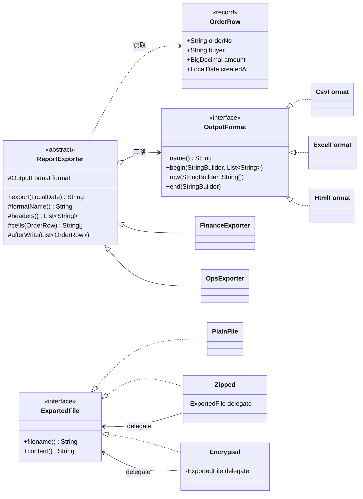
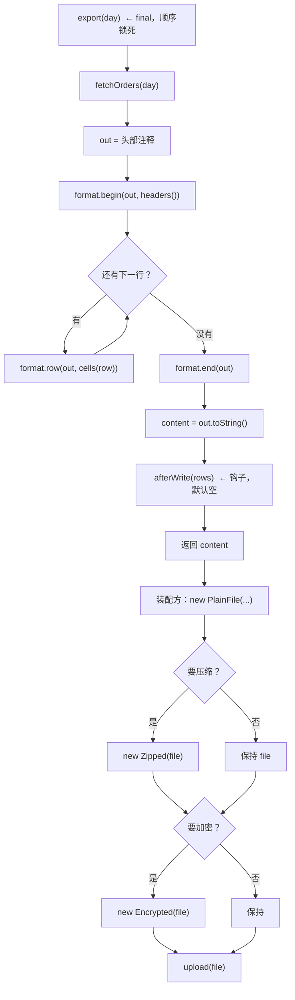

# 练习 04 · 报表文件导出

> **难度** ★★★☆☆ ｜ **建议时长** 50 分钟 ｜ **参考实现** [`solutions/ReportExportSolution.java`](solutions/ReportExportSolution.java)
>
> **先修**：[模板方法](../../src/com/patterns/behavioral/templatemethod/README.md) · [策略模式](../../src/com/patterns/behavioral/strategy/README.md) · [装饰器](../../src/com/patterns/structural/decorator/README.md)
>
> ⚠️ 这个练习只考一件事：**模板方法和策略不是二选一**。请先做完任务 B 再往下看。

---

## 1. 业务背景

后台要导出订单报表。一开始只要 CSV，后来加了 Excel、HTML。同时报表有**两种口径**：财务口径（金额带币种、日期 ISO）和运营口径（金额取整、日期中文、多一列档位）。

导出后还要支持压缩、加密，再上传到对象存储。

## 2. 初始实现

```java
static String exportCsv(List<OrderRow> rows) {
    StringBuilder out = new StringBuilder();
    out.append("订单号,买家,金额,下单日期\n");
    for (OrderRow row : rows) {
        out.append(row.orderNo()).append(',')
           .append(row.buyer()).append(',')
           .append(row.amount()).append(',')
           .append(row.createdAt()).append('\n');
    }
    return out.toString();
}
```

## 3. 需求一波一波来了

### v2

- 加 Excel。表头一样，但用制表符分隔，且要有 `[Workbook]` / `[EOF]` 外壳。
- 加 HTML。要转义 `<` `>` `&`。

### v3

- 加运营口径：金额按整数取整、日期 `2026年11月8日`、多一列"金额档位"（大额/中额/小额）。

### v4

- 导出后要压缩。
- 有的客户要加密。
- 压缩和加密可以同时要。

### v5

- 加 PDF、加"按门店分组汇总"、加"导出到 FTP"，同时财务口径要改成"含税额"。

## 4. 你的任务

### 任务 A：数一数（10 分钟）

当前维度：

- 格式：CSV / Excel / HTML / PDF
- 口径：财务 / 运营 / 按门店分组
- 后处理：无 / 压缩 / 加密 / 压缩+加密

1. 如果**只有一套类**按"格式 × 口径"组合，v5 之后有多少个类？
2. 如果用两个维度独立扩展，有多少个类？
3. 后处理那一维为什么**不能**和格式合并？

### 任务 B：判断每个维度该用什么机制（20 分钟）

三个维度，分别回答：

| 维度 | 变化特征 | 你选的机制 | 为什么不是别的 |
|---|---|---|---|
| **格式** | 三个月加一种，每种实现完整且互不使用 | | |
| **口径** | 两种，差异只在"列怎么映射" | | |
| **后处理** | 可自由叠加（压缩 + 加密），且作用于整个文件 | | |

**关键问题**：
- "取数 → 遍历 → 写出 → 收尾"这个**顺序**会变吗？如果要锁住它，用什么？
- 三种格式的"写出"实现能互相替换吗？能替换 → 说明它是哪个机制？
- 压缩和加密能任意叠加吗？能叠加且不改变接口 → 说明它是哪个机制？
- 为什么后处理**不能**做成格式的装饰器？

### 任务 C：找出会重复的代码（15 分钟）

假设你把"整个导出"都做成策略（`CsvExporter` / `ExcelExporter` / `HtmlExporter` 三个独立完整类）：

1. 三个类里各有哪几行是重复的？
2. v5 加"按门店分组"时，要改几个类？
3. 假设取数逻辑改成"分页拉取"，要改几个类？

## 5. 自检清单

<details>
<summary>点开自检清单</summary>

| # | 问题 | 及格答案 |
|---|---|---|
| 1 | v5 之后"格式 × 口径"有多少组合？ | 4 × 3 = 12 个类（如果打平）。两个维度独立扩展是 4 + 3 = 7 个类。 |
| 2 | 顺序会变吗？ | **不会**。取数 → 转换 → 写出 → 收尾，四年没变。所以用模板方法锁住（`final`）。 |
| 3 | 格式能互相替换吗？ | 能。同一份数据，CSV 或 Excel。→ **策略**。 |
| 4 | 后处理能叠加吗？ | 能，且顺序可变（先压后加 vs 先加后压）。→ **装饰器**。 |
| 5 | 为什么后处理不能套在格式上？ | 作用粒度不同。格式处理的是**一行**（`row(String[])`），压缩加密处理的是**整个文件**。套在格式上就得逐行压缩，逻辑荒谬。 |
| 6 | 全做成策略会重复什么？ | 取数、遍历、收尾各重复 3 遍。加一个口径要改 3 个类。 |
| 7 | 全做成模板方法会怎样？ | 格式差异挤进父类的 `switch`，加一种格式改父类。 |

**评分**：6~7 分往下看；4~5 分重读 [模板方法适用边界](../../src/com/patterns/behavioral/templatemethod/README.md)；0~3 分先做 [模板方法入门 Demo](../../src/com/patterns/behavioral/templatemethod/beginner/BeginnerDemo.java)。

</details>

---

<div align="center">

# ⬇️ 以下为参考答案

</div>

---

## 6. 核心判断：一个维度只能用一个机制

这是本练习唯一需要记住的结论：

> **两个变化维度，就要两个独立机制。用一个机制覆盖两个维度，必然产生笛卡尔积。**

```
格式（4 种）  ×  口径（3 种）  =  12 个类   ← 打平
格式（4 种）  +  口径（3 种）  =  7 个类    ← 分开
```

但"分开"有个前提：**两个维度必须能正交组合**。如果不是任意格式都能配任意口径（比如 PDF 只支持财务口径），那就要多一层约束 —— 这层约束放在装配处，不要放在类里。

## 7. 三个机制各自负责什么

| 维度 | 机制 | 关键设计 | 如果选错 |
|---|---|---|---|
| 顺序 | **模板方法** | `export()` 是 `final`，子类只实现钩子 | 顺序会被各实现偷偷改掉（先写后取、忘了关流） |
| 格式 | **策略** | `OutputFormat` 只负责 `begin/row/end` | 每个实现都要自己取数 |
| 后处理 | **装饰器** | 实现同一个 `ExportedFile` 接口 | 组合数爆炸（压缩+加密要单独写一个类） |

**模板方法的钩子应该多细？**

这个练习里的 `ReportExporter` 有四个抽象/钩子点：

```java
protected abstract String formatName();           // 头部注释
protected abstract List<String> headers();        // 列名
protected abstract String[] cells(OrderRow row);  // 一行数据
protected void afterWrite(List<OrderRow> rows) {} // 钩子：默认空
```

判断标准：**每个钩子必须对应一个真实的变化维度**。

- `headers()` / `cells()` 对应"口径"这一维（财务 vs 运营）；
- `afterWrite` 对应"导出后要落盘 / 记数"这一维；
- `formatName()` 严格说可以省掉（`format.name()` 就够了），保留是因为"报表标题"是业务信息，不该由格式决定。

如果再加一个"每 1000 行 flush 一次"的钩子，而三种格式都不需要 —— 那就是过度设计。

## 8. 为什么后处理必须是装饰器

```java
interface ExportedFile {
    String filename();
    String content();
}
```

三个实现：`PlainFile`（被装饰者）、`Zipped`、`Encrypted`。

**关键点 1：装饰器实现同一接口**。这是装饰器和"普通包装类"的区别。`Zipped` 也满足 `ExportedFile`，所以可以再被 `Encrypted` 包。

**关键点 2：顺序可变且语义不同**。

```
new Encrypted(new Zipped(base))  → 先压缩，再加密  → .csv.zip.enc
new Zipped(new Encrypted(base))  → 先加密，再压缩  → .csv.enc.zip
```

两者都合法，取决于客户要求。**如果用继承做组合**（`ZippedEncryptedFile extends EncryptedFile`），就只能支持一种顺序，且加第三种后处理要 2^n 个类。

**关键点 3：作用粒度决定层级**。

| 后处理 | 作用对象 | 套在哪 |
|---|---|---|
| 压缩 / 加密 | 整个文件 | `ExportedFile` |
| 金额格式化 | 一行 | `OutputFormat` |
| 加一列 | 一行 | `ReportExporter.cells()` |
| 加表头注释 | 整体开头 | `ReportExporter.export()` |

这就是"装饰器套在哪一层"的通用判据：**看它处理的对象粒度，不要看代码像不像装饰器**。

## 9. UML



**读图要点**：

- `ReportExporter o--> OutputFormat`：**聚合**（不是组合）。因为格式是外部注入的，生命期由装配方管；
- `ReportExporter` 是抽象类 + `export()` 具体方法（模板方法）；两个子类只覆盖钩子，不覆盖 `export`；
- `Zipped` / `Encrypted` **同时** `..|> ExportedFile` 和 `--> ExportedFile` —— 这两条线同时出现就是装饰器的签名；
- 注意图上**没有** `ReportExporter` 到 `ExportedFile` 的连线：导出产出的 String 由装配方包成文件。这是两个阶段，不该混在一起。

## 10. 执行流程



**两个阶段的分界线在 K**：模板方法产出的是**字符串**，装饰器处理的是**文件**。这个分界很重要 —— 如果让 `ReportExporter` 直接返回 `ExportedFile`，压缩加密就会和精神上属于"导出"的代码搅在一起。

## 11. 参考实现

完整可运行代码：[`solutions/ReportExportSolution.java`](solutions/ReportExportSolution.java)（约 380 行）

```bash
java docs/practice/solutions/ReportExportSolution.java
```

输出里五段：

1. **同一模板三种格式** —— CSV / Excel / HTML 的实际差异（转义规则、表头外壳）；
2. **同一模板换口径** —— 财务 vs 运营，只有 `headers()` / `cells()` 变了；
3. **加格式的改动面** —— 新增 1 个类，两个子类不动；
4. **装饰器自由叠加** —— 四种文件形态（原文件、zip、enc、zip.enc）上传记录；
5. **两个反例** —— 全做成策略会重复什么，全做成模板方法会挤什么。

关键片段（`export` 为什么必须 `final`）：

```java
final String export(LocalDate day) {
    List<OrderRow> rows = fetchOrders(day);
    StringBuilder out = new StringBuilder();
    out.append("# ").append(formatName()).append(" 导出 ").append(day).append('\n');
    format.begin(out, headers());
    for (OrderRow row : rows) {
        format.row(out, cells(row));
    }
    format.end(out);
    String content = out.toString();
    afterWrite(rows);
    return content;
}
```

一旦放开这个 `final`，就会出现"Excel 要先写 100 行再写表头"这种需求 —— 那时顺序就不再是骨架，整个模板方法的意义也就没了。

## 12. 为什么不选其他模式

| 候选 | 为什么不用 |
|---|---|
| **工厂方法** | 可以解决"按格式创建导出器"，但格式的数量不是配置驱动（后台没有 `format=PDF` 的选项表），用工厂多一层间接。**如果**以后要做"运营配一个格式名就自动出报表"，那时工厂才合适。 |
| **建造者** | `ReportExporter` 的构造参数只有 1 个（format）。建造者适合"5 个以上可选参数"的场景。 |
| **外观** | `ReportExporter` 确实封装了"取数 + 遍历 + 写出"，但外观是**一个门面替多个子系统**，而这里只有一个子系统（格式策略）。命名为"模板方法"更准确。 |
| **全策略（把整个导出做成策略）** | 见任务 C。重复 3 遍取数和收尾，加口径改 3 个类。 |
| **全模板方法（格式塞进父类 switch）** | 转义规则、表头写法、结尾闭合挤在一个方法里；无法在不改父类的前提下加格式。 |
| **责任链** | 没有"短路"需求。压缩和加密不是"二选一"，是"都要"。 |

## 13. 过度设计的四种样子

1. **给 `OutputFormat` 加 `supports(ReportType)`**。除了 PDF 只支持财务口径这一种情况，其他格式都全支持 —— 一个特例不值得加一个方法。
2. **`ReportExporter` 加一个 `Pipeline` 字段**。"以后可能要插步骤"，等真有第二个步骤再改。
3. **后处理做成插件 + SPI**。压缩和加密是内部实现，不是第三方扩展点。
4. **导出加"模板引擎"**。"报表格式以后会很复杂" —— 先问：现在的格式复杂度真的比模板引擎的运维成本高吗？CSV 的转义规则是 3 行代码。

## 14. 延伸

- **想看模板方法的经典工程用法**：[`behavioral/templatemethod`](../../src/com/patterns/behavioral/templatemethod/README.md)
- **想看装饰器的更多层数**：[`structural/decorator`](../../src/com/patterns/structural/decorator/README.md)
- **想理解"策略和模板方法怎么选"**：[选择指南 §6](../pattern-selection-guide.md) 的"模板方法 vs 策略"小节 —— 判据是"变化的是步骤内实现，还是步骤的集合本身"。
- **想看真实项目里的导出模块**（Spring Batch 的 `ItemReader/Processor/Writer`）：[docs/06-modern-scenarios.md](../06-modern-scenarios.md)。

---

**上一节**：[练习 03 · 消息通知系统](03-notification.md) ｜ **下一节**：[练习 05 · 下单接口处理管线](05-api-request.md)
