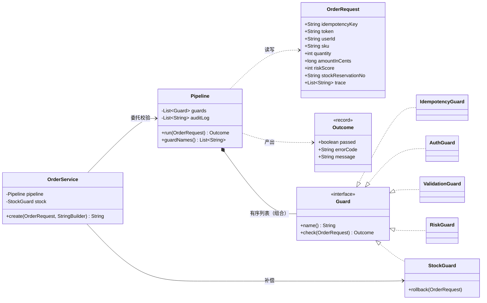
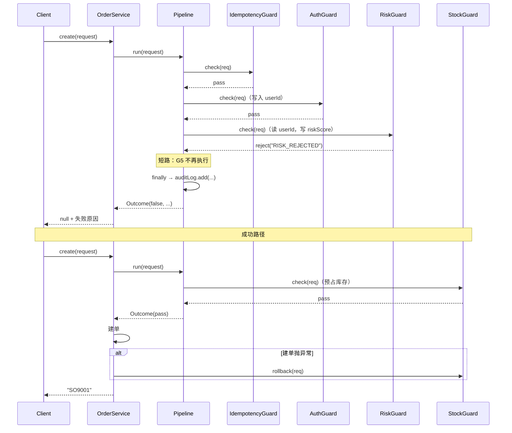

# 练习 05 · 下单接口处理管线

> **难度** ★★★★☆ ｜ **建议时长** 60 分钟 ｜ **参考实现** [`solutions/OrderApiSolution.java`](solutions/OrderApiSolution.java)
>
> **先修**：[责任链](../../src/com/patterns/behavioral/chainofresponsibility/README.md) · [装饰器](../../src/com/patterns/structural/decorator/README.md) · [代理](../../src/com/patterns/structural/proxy/README.md)
>
> ⚠️ 这个练习最容易做错的地方不是"选哪个模式"，而是**以为一个模式能解决所有事**。请认真做任务 C。

---

## 1. 业务背景

你负责"创建订单"这个接口。上线时的实现是一个 80 行的 `OrderController.create()`：

```java
@PostMapping("/orders")
public Result<OrderVO> create(@RequestBody CreateOrderRequest req, HttpHeaders headers) {
    // 1. 幂等
    if (!idempotentService.tryLock(req.idempotencyKey())) {
        return Result.fail("DUPLICATE_SUBMIT");
    }
    // 2. 登录
    Long userId = tokenService.parse(headers.getAuthorization());
    if (userId == null) return Result.fail("UNAUTHORIZED");
    // 3. 参数
    if (req.quantity() <= 0) return Result.fail("INVALID_QUANTITY");
    if (req.amount() <= 0) return Result.fail("INVALID_AMOUNT");
    // 4. 风控
    int score = riskService.score(userId, req);
    if (score >= 50) return Result.fail("RISK_REJECTED");
    // 5. 库存
    String rsvNo = stockService.reserve(req.sku(), req.quantity());
    if (rsvNo == null) return Result.fail("OUT_OF_STOCK");
    // 6. 建单
    Order order = orderService.create(userId, req);
    // 7. 埋点
    auditLog.record(userId, "CREATE_ORDER", order.getId());
    return Result.ok(OrderVO.of(order));
}
```

## 2. 需求一波一波来了

### v2

- 加"黑名单校验"（在登录之后，风控之前）。
- 加"限流"（在幂等之前）。
- 「查询订单」接口**不需要**风控和库存，但需要登录和参数校验。

### v3

- 支付回调接口（`/pay/callback`）走另一套校验：验签 → 幂等 → 改状态。**和下单完全不同的链**。
- 也就是说，不同的入口走不同的节点子集。

### v4

- **埋点必须在失败时也记录**。现在的代码里"失败 return"直接跳过了第 7 步 —— 这是一个线上事故：有一次风控误杀了 3 万单，因为没有埋点，两小时后才发现。
- 加"耗时统计"：每个环节各花了多少毫秒。

### v5

- 库存预占后发现"用户优惠券已被占用"，需要**回滚预占**。
- 有些入口要做"灰度开关"，某些节点只对 10% 流量生效。

## 3. 你的任务

### 任务 A：找出"不该进链"的东西（15 分钟）

把 v2~v5 里的每一条，判断它属于哪一类：

| 需求 | 类型 | 理由 |
|---|---|---|
| 加黑名单 | ☐ 校验（可短路）☐ 增强（必须执行）☐ 副作用 | |
| 加限流 | ☐ 校验 ☐ 增强 ☐ 副作用 | |
| 不同入口不同子集 | ☐ 校验 ☐ 增强 ☐ 副作用 | |
| **埋点失败也记录** | ☐ 校验 ☐ 增强 ☐ 副作用 | |
| 耗时统计 | ☐ 校验 ☐ 增强 ☐ 副作用 | |
| 库存回滚 | ☐ 校验 ☐ 增强 ☐ 副作用 | |
| 灰度开关 | ☐ 校验 ☐ 增强 ☐ 副作用 | |

**关键问题**：如果一条需求是"增强"或"副作用"，把它塞进责任链会发生什么？用 v4 的埋点举例说明。

### 任务 B：设计链的骨架（25 分钟）

写出你的设计：

```
这是一条什么链？______________________（一个请求、多个候选、选一个？还是全部走一遍？）

节点接口签名：______________________
  返回什么？为什么不能是 void？______________________
  要不要 setNext？______________________

链的顺序由谁决定？______________________
```

然后回答：

1. 库存预占是"校验"还是"副作用"？把它放进链里，会有什么问题？
2. v4 的"埋点失败也记录"用链怎么实现？（提示：想想链失败时会发生什么）
3. v5 的"灰度开关"应该放在节点里还是链外？

### 任务 C：顺序是契约（20 分钟）

假设有人把"风控"排到了"登录"前面：

1. 会发生什么？（`userId` 是 null 时，风控怎么判断？）
2. 编译器会报错吗？
3. 这个错误的**表现**是什么？是报错，还是静默的错误行为？
4. 有什么办法让顺序错误在**启动时**就暴露？（提示：可以声明依赖）

## 4. 自检清单

<details>
<summary>点开自检清单</summary>

| # | 问题 | 及格答案 |
|---|---|---|
| 1 | 校验 vs 增强怎么分？ | 校验可以**终止**流程；增强**必须**在成功和失败时都执行。 |
| 2 | 埋点进链会怎样？ | 链短路时直接跳过，埋点永远只记录成功的请求 —— 正是 v4 的事故。 |
| 3 | 节点接口为什么必须返回值？ | 链需要知道"要不要继续"。`void` 无法短路。 |
| 4 | 库存预占是校验吗？ | **一半**。检查库存是校验，扣减是副作用。混在一起就会出现"后面拒绝了，前面没回滚"。 |
| 5 | 正确做法是什么？ | 链只放**纯校验**；副作用放业务层，由业务层统一补偿。 |
| 6 | 顺序错了会报错吗？ | **不会**。这是责任链最贵的代价：顺序只存在于装配代码里。 |
| 7 | 怎么让顺序错误提前暴露？ | 声明依赖（如 `RiskGuard` 要求 `AuthGuard` 已执行，校验 `userId != null` 并**拒绝**而不是跳过）。 |
| 8 | 灰度开关放哪？ | 链外（装配时决定加不加节点），或作为装饰器包住某个节点。放节点内部会让每个节点都要写一遍开关逻辑。 |

**评分**：7~8 分可以看答案；5~6 分重读 [责任链适用边界](../../src/com/patterns/behavioral/chainofresponsibility/README.md)；0~4 分先做 [责任链入门 Demo](../../src/com/patterns/behavioral/chainofresponsibility/beginner/BeginnerDemo.java)，再看 [综合案例 apigateway](../../src/com/patterns/combined/apigateway/README.md)。

</details>

---

<div align="center">

# ⬇️ 以下为参考答案

</div>

---

## 5. 核心判断：链只能装"能说不"的东西

这是本练习最重要的一句话：

> **责任链的每一个节点都有权终止流程。凡是不该有权终止的东西，都不能进链。**

由此得到一张分类表：

| 类型 | 能不能终止 | 进链吗 | 例子 |
|---|---|---|---|
| **纯校验** | 能 | ✅ 进 | 幂等、登录、参数、风控、限流、黑名单 |
| **副作用** | 能（但终止后要补偿） | ❌ 不进 | 库存扣减、优惠券锁定、扣款 |
| **增强** | 不能 | ❌ 不进（用 finally / 装饰器） | 埋点、耗时统计、日志 |

**为什么"增强"不能进链**：因为链一旦短路，后面的节点全部不执行。把埋点放在链尾，等于"只埋成功请求的日志" —— 恰恰是最需要日志的失败请求没有记录。

正确做法是把增强放在**链的外层**：

```java
Outcome run(OrderRequest request) {
    try {
        for (Guard guard : guards) {
            Outcome outcome = guard.check(request);
            if (!outcome.passed()) {
                return outcome;          // 短路
            }
        }
        return Outcome.pass();
    } finally {
        auditLog.add(...);               // 短路也执行
    }
}
```

## 6. 为什么副作用也不能进链

看这个顺序：

```
幂等 → 登录 → 参数 → 风控 → 库存预占 → 建单
```

如果"建单"失败（数据库主键冲突），链已经跑完了，库存扣了但订单没建 → **超卖**。

三种补救方案：

| 方案 | 问题 |
|---|---|
| 在链里 try-catch 回滚 | 链不知道哪些节点有副作用，只能全部回滚（有些不能回滚） |
| 每个节点自己回滚 | 节点要持有"上游节点"的引用，链变成网状 |
| **副作用全部搬到业务层** | ✅ 链只判断"能不能做"，业务层负责"做 + 失败补偿" |

参考实现选的是第三种：

```java
// 链里：只检查库存够不够（不扣）
// 业务层：扣减 → 建单 → 失败则回滚
```

**代价**：库存检查和扣减之间有一个时间窗口（并发下可能超卖）。真实系统里这个窗口用"预占 + 超时释放"解决，而预占本身就是副作用 —— 所以最终还是回到"副作用要在业务层"。

## 7. 顺序是隐式契约

这是责任链最贵的代价，值得单独一节。

```java
Pipeline.builder()
    .add(new IdempotencyGuard())
    .add(new RiskGuard(50))        // ← 有人把它挪到了这里
    .add(new AuthGuard())
```

风控的 `check` 里读 `request.userId`，此时它是 `null`。如果风控写的是：

```java
if (request.userId == null) {
    return Outcome.pass();     // ← 防御性写法，看起来很安全
}
```

后果：**所有请求都跳过风控**。没有异常、没有日志、没有告警，只有半年后的复盘报告。

参考实现里的写法是**拒绝**：

```java
if (request.userId == null) {
    return Outcome.reject("RISK_NO_USER", "风控无法识别用户，拒绝交易");
}
```

这叫**失败关闭（fail-closed）**：宁可错杀，不可放过。安全相关的节点必须这样写。

三个让顺序契约可见的办法（按成本从低到高）：

| 办法 | 效果 | 成本 |
|---|---|---|
| 节点内 fail-closed | 顺序错 → 明显报错，不会静默 | 每个节点多 3 行 |
| 节点声明依赖 + 装配时校验 | 启动就失败 | 一个 `requires()` 方法 + 装配循环检查 |
| 把顺序编进类型（如 `Pipeline<AfterAuth>`） | 编译期保证 | 类型体操，几乎没人这么做 |

## 8. UML



**读图要点**：

- 图上**没有** `Guard --> Guard next` 的自关联。因为链的遍历由 `Pipeline` 的 `for` 循环做，而不是节点互相持有 —— 这是"链"的另一种实现方式，比节点互相持有更简单（不需要 `setNext`，也不会有编译器看不到的顺序）；
- `Pipeline *-- Guard` 用**组合**：管线的生命期包含节点，管线销毁节点也销毁；
- `OrderService --> Pipeline`（普通关联）和 `OrderService --> StockGuard`（直接依赖具体类）：补偿逻辑必须是具体的，因为它要知道"怎么回滚"；
- `StockGuard` **同时**是 `Guard` 和补偿提供者 —— 这是它的问题所在（一个类承担两个角色）。参考实现保留它是为了让"副作用进链"的问题可见，真实项目里应该拆成 `StockChecker`（Guard）+ `StockService`（补偿）。

## 9. 执行流程



**注意两处**：

1. 风控拒绝时，`StockGuard` 根本没执行 → 没有预占 → 不需要补偿。这就是"纯校验进链、副作用进业务层"的好处：**回滚的可能范围被限定在业务层内部**。
2. `finally` 里的审计记录在短路时也执行。

## 10. 参考实现

完整可运行代码：[`solutions/OrderApiSolution.java`](solutions/OrderApiSolution.java)（约 460 行）

```bash
java docs/practice/solutions/OrderApiSolution.java
```

输出里五个场景：

1. **正常下单** —— 链路顺序、trace 全记录、审计 1 条；
2. **风控拒绝** —— 库存预占没出现在 trace（短路生效），审计仍有 1 条（finally 生效）；
3. **顺序错了** —— 风控排到登录之前，所有正常请求被拒；编译器无提示；
4. **重复提交** —— 幂等挡住第二次，库存只扣 1 件；
5. **回滚** —— 预占后调用 `rollback`，库存还原。

关键片段（`Pipeline.run` 的 try/finally）：

```java
Outcome run(OrderRequest request) {
    try {
        for (Guard guard : guards) {
            Outcome outcome = guard.check(request);
            if (!outcome.passed()) {
                return outcome;
            }
        }
        return Outcome.pass();
    } finally {
        auditLog.add(request.idempotencyKey + " | 链路 " + guardNames() + " | trace=" + request.trace);
    }
}
```

**为什么 `Pipeline` 用 `for` 循环遍历，而不是节点互相持有 next**：

| 方式 | 优点 | 缺点 |
|---|---|---|
| 节点持有 next | 经典形态，节点可复用 | 需要 `setNext`，装配容易出错（见练习 01 的坑） |
| 管线持有序列表 | 装配简单、顺序集中可见、可随时打印 | 节点不能脱离管线单独串 |

这个练习选后者，因为**顺序是装配问题，不是节点问题**。

## 11. 为什么不选其他模式

| 候选 | 为什么不用 |
|---|---|
| **装饰器** | 装饰器**必须**调用被装饰者，语义是"前后加料，核心一定跑"。校验的语义是"不通过就停" —— 所以只能短路。判据：每个环节都必须执行 → 装饰器；有环节能终止 → 链。 |
| **策略** | 策略是"调用方选一个实现"。这里是"按固定顺序全部跑一遍，直到有人说不"。**同一环节的多种实现**（如三种登录方式）可以用策略，那是链节点内部的策略。 |
| **管道/过滤器（Pipeline + Filter）** | 这就是链的 Java 实现名（Servlet Filter、Netty ChannelPipeline）。名字不同，机制相同。 |
| **AOP / 拦截器** | Spring 的 `HandlerInterceptor` 本质也是链，且由框架管顺序。**如果你在用 Spring，优先用框架的链**，不要自己造一个 —— 那是重复开发。这个练习用纯 Java 是为了让你看清机制。 |
| **状态模式** | 状态是"同一对象在不同阶段对同一请求有不同反应"。请求管线没有"当前阶段"的概念，每次都是从第一个节点开始。 |
| **中介者** | 节点之间不互相通信（只和上下文通信），没有需要消除的连线。 |

## 12. 过度设计的四种样子

1. **给 `Guard` 加 `order()` 返回排序号**。一旦有排序号，就要处理"同号怎么办"，还要处理"注解和代码两处顺序冲突"。链的顺序放在装配代码里，一眼能看完。
2. **给每个节点配一个 `XxxGuardConfig` + `XxxGuardFactory`**。5 个节点生出 15 个类，最后还是 `new` 一下。
3. **把链做成可热更新的**。"后台配置校验节点" —— 先问：真的需要不发版就改校验规则吗？如果只是"大促期间多一个节点"，一个开关字段就够。
4. **自己实现一个 AOP 框架**。Java 有动态代理，Spring 有 AOP，Netty 有 Pipeline。**先看框架提供了什么**，再决定要不要自己写。

## 13. 延伸

- **想看责任链的三种形态对比**：[`behavioral/chainofresponsibility`](../../src/com/patterns/behavioral/chainofresponsibility/README.md) —— 审批链（经典）、优惠链（带共享状态）、入门版。
- **想看工业级的链**：[`combined/apigateway`](../../src/com/patterns/combined/apigateway/README.md) —— 6 个中间件、渐进式装配、短路返回。
- **想看"装饰器和链怎么选"**：[选择指南 §6](../pattern-selection-guide.md) 的"责任链 vs 装饰器"小节。
- **想看真实框架里的链**：[docs/06-modern-scenarios.md](../06-modern-scenarios.md) 的 Netty ChannelPipeline 与 Spring MVC 拦截器章节。
- **想理解"管道"这个词的历史**：[docs/02-pattern-comparison.md](../02-pattern-comparison.md) 里有 Unix pipe 与责任链的对照。

---

**上一节**：[练习 04 · 报表文件导出](04-file-export.md) ｜ **下一节**：[实践总览](README.md)
